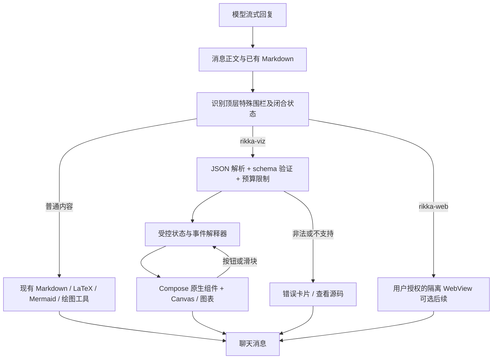

# RikkaHub：AI 交互式可视化引擎开发方案

> 面向本地 Codex 的实施文档 · 2026-11-14 · 协议草案 v1
> 
> 项目：`fmjj-ai/rikkahub`；基于远端分支 `codex/upstream-integration-20261102` 的已读源码。**直接在你电脑当前的开发分支继续实现，不要新建分支，不要覆盖未提交修改，不要自动提交或推送。** 本文是设计与示例，不代表已经修改仓库或完成 Android 编译。

## 0. 给本地 Codex 的任务摘要

目标：让 AI 在普通 Markdown 回复中按需插入可直接操作的原生图形、滑块、按钮、教学模拟器。体验参考 ChatGPT 的消息内交互式图形，但不假设或复刻其私有实现。采用 **受控 JSON 声明式协议 + Compose 原生渲染为主 + 可选隔离 WebView 为辅**；不是每个学科写一个固定 UI，也不是把所有消息交给 WebView。

先实现原生 MVP，再考虑 Web 扩展。保留现有函数绘图工具、HTML/SVG/Mermaid 预览、数学公式和普通 Markdown。先阅读本地源码和未提交 diff，若本地已实现类似模块则复用；按第 11 节顺序修改。所有演示代码在第 7、8 节，内置提示词在第 9 节。命名为建议，和现有架构冲突时可调整，但协议语义保持统一。

## 1. 之前的演示到底是什么

之前展示的 CPU 单总线/三总线、寄存器计数、二次函数滑块、排序、单位圆，本质上都可由如下公开技术实现：

- SVG 是 XML 风格的矢量图形：`rect` 画寄存器，`line/path` 画连线，`text` 写文字，`circle` 画圆。
- 状态保存数值，例如 `step=0`、`a=1`、`angle=45`。点击或拖动只改变本地状态，图形根据状态重新计算；不需要向模型再发送请求。
- 普通网页可以使用 HTML + SVG + JS 实现；原生 Android 可以使用 Compose State + Canvas/Path + Material3 控件实现同样效果。
- ChatGPT 客户端的具体私有协议、源代码和底层实现并未在本次查阅中确认。本文示例是独立、可修改的等效实现，不是从 ChatGPT 提取的源码。

### 图形如何与状态联动

```text
初始状态 {step: 0, r1: 5, r2: 7}
        ↓
用户点击下一步 → 受控事件 → 更新状态 {step: 1, ...}
        ↓
Compose 重组 / 网页 render() → 重新计算数字、颜色、坐标
        ↓
用户立即看见新图形（无模型 API 调用）
```

数学曲线也不是生成一张图片：给定 x 采样点，计算 y，转换成屏幕坐标后画线。滑块改变系数，重新采样即可。

## 2. 仓库现状与具体接入点（已核对远端）

以下路径以 `app/src/main/java/me/rerere/rikkahub/` 为根。行号只反映查阅快照，本地可能已有修改。分支名并不是单独的 `codex`。

| 已确认文件 | 现状 | 实施建议 |
|---|---|---|
| [`ui/components/message/ChatMessage.kt`](https://github.com/fmjj-ai/rikkahub/blob/codex/upstream-integration-20261102/app/src/main/java/me/rerere/rikkahub/ui/components/message/ChatMessage.kt) | 约 270–425 行：`MessagePartsBlock` 根据角色和消息类型渲染；已有 `GraphDisplayBlock` → `PlotFunctionToolContent`；流式生成时禁用 SelectionContainer | 传入消息身份、角色、是否生成中等上下文；不改坏已有绘图工具和选择逻辑 |
| [`ui/components/richtext/Markdown.kt`](https://github.com/fmjj-ai/rikkahub/blob/codex/upstream-integration-20261102/app/src/main/java/me/rerere/rikkahub/ui/components/richtext/Markdown.kt) | 161–210 行：异步 `prepareMarkdownState` 保留一致快照；有 `MarkdownNew` DOM 分支及 AST 分支；约 522–551 行 AST `CODE_FENCE` 读取语言和结束标记 `hasEnd` | 两条路径都必须识别新协议，或在 Markdown 入口先做独立 fence 分段；不能只改 AST |
| [`ui/components/richtext/MarkdownNew.kt`](https://github.com/fmjj-ai/rikkahub/blob/codex/upstream-integration-20261102/app/src/main/java/me/rerere/rikkahub/ui/components/richtext/MarkdownNew.kt) | 466–481 行：`HtmlCodeBlock` 从 `language-*` 类取语言，使用 `wholeText()`；传入 `completeCodeBlock=true` | DOM 的 `true` 不足以证明源 Markdown 已闭合；使用原始源 fence 元数据，不允许提前执行 |
| [`ui/components/richtext/HighlightCodeBlock.kt`](https://github.com/fmjj-ai/rikkahub/blob/codex/upstream-integration-20261102/app/src/main/java/me/rerere/rikkahub/ui/components/richtext/HighlightCodeBlock.kt) | 约 88–180 行：HTML/SVG 完整代码块默认内嵌预览，Mermaid 单独渲染；约 477–506 行：`CodeBlockPreview` 使用 WebView，固定高度 200dp | 可以复用源码折叠/复制操作；新协议独立 renderer，不受普通代码块默认折叠设置影响 |
| [`ui/components/richtext/SimpleHtmlBlock.kt`](https://github.com/fmjj-ai/rikkahub/blob/codex/upstream-integration-20261102/app/src/main/java/me/rerere/rikkahub/ui/components/richtext/SimpleHtmlBlock.kt) | 原生 HTML 子集解析 | 不要误以为支持任意 JS；保持原功能 |
| [`ui/components/webview/WebView.kt`](https://github.com/fmjj-ai/rikkahub/blob/codex/upstream-integration-20261102/app/src/main/java/me/rerere/rikkahub/ui/components/webview/WebView.kt) | 通用 wrapper 默认启用 JS、DOM storage、content access，支持 `addJavascriptInterface`；资源拦截未命中时调用 super | **不能直接作为不可信模型脚本的安全沙箱**；新增专用隔离组件，普通浏览/预览不与其混用 |
| [`data/model/Assistant.kt`](https://github.com/fmjj-ai/rikkahub/blob/codex/upstream-integration-20261102/app/src/main/java/me/rerere/rikkahub/data/model/Assistant.kt) | `systemPrompt`、`streamOutput`、`localTools`（含 `FunctionGraph`）、模式注入、对话级 system prompt 覆写 | 加可视化能力开关，与原绘图工具共存 |
| [`data/ai/transformers/PromptInjectionTransformer.kt`](https://github.com/fmjj-ai/rikkahub/blob/codex/upstream-integration-20261102/app/src/main/java/me/rerere/rikkahub/data/ai/transformers/PromptInjectionTransformer.kt) | 模式/Lorebook 注入，处理系统提示词前后、深度等位置 | 查明完整请求构建顺序后，新增专门的能力说明注入或复用可靠的注入管道 |
| [`data/datastore/Settings.kt`](https://github.com/fmjj-ai/rikkahub/blob/codex/upstream-integration-20261102/app/src/main/java/me/rerere/rikkahub/data/datastore/Settings.kt) | `DisplaySetting` 有代码折叠、自动换行、LaTeX、主题等 | 加全局显示开关、资源预算；序列化字段提供默认值 |
| [`app/build.gradle.kts`](https://github.com/fmjj-ai/rikkahub/blob/codex/upstream-integration-20261102/app/build.gradle.kts) | Kotlin serialization、Compose、Material3，minSdk 26、targetSdk/compileSdk 37（远端快照） | 原生 MVP 不需要引入 React/浏览器引擎；使用现有依赖及版本目录 |

未读取完整请求装配链、全部 Markdown 预处理实现和本地最新修改，故不要把下面建议的新类名当成已经存在的文件。可先运行：

```bash
git status --short --branch
rg -n 'prepareMarkdownState|MarkdownPreparationState|MarkdownNew\(|HighlightCodeBlock\(' app/src
rg -n 'PromptInjectionTransformer|InputMessageTransformer|systemPrompt|FunctionGraph|plot_function' app/src ai/src
rg -n 'WebViewLocalAssets|WebViewContentCache|rememberWebViewState|DisplaySetting\(' app/src
```

## 3. 整体架构与取舍



| 路线 | 适用 | 取舍 |
|---|---|---|
| Compose 声明式 JSON（首选） | 教学图、滑块、计算器、步骤动画、简单交互 | 原生主题、无任意 JS、滚动更好；需要实现受控解释器 |
| 安全的 SVG/Canvas 子集 | CPU、链表、树、网络、几何 | 精确绘制；不要开放 SVG 中的 script、外链、foreignObject 等 |
| 可选 WebView（第二阶段） | 超复杂交互、离线 3D、WebGL | 灵活但隔离难；默认关闭或需要用户点击运行 |
| 现有 `plot_function` 工具 | 专门数学函数图、已有坐标轴/缩放等 | 保留，别为了通用协议重复实现全部功能 |

MVP 不增加新的模型供应商 API、tool call 或服务端。模型输出普通文本中的特殊 fence，即使模型不支持 function calling 也能用。之后若需要严格结构输出，可以增加独立 `render_visualization` 工具，复用同一校验和 renderer；不要在 MVP 同时实现两种通信通道。

建议的目录（新建，按本地风格调整）：

```text
ui/components/visualization/
  VisualizationBlock.kt          # 卡片、错误状态、源码切换、重置
  VizSchema.kt                   # 协议与类型
  VizParser.kt                   # 严格 JSON + schema + 资源预算
  VizExpression.kt               # 受控表达式计算
  VizReducer.kt                  # 纯状态更新、事件验证
  VizStateStore.kt               # 消息级状态，生命周期和 LRU
  VizRenderer.kt                 # Compose 节点分发
  VizCanvas.kt                   # 坐标转换、绘制 primitive、裁剪
  VizFenceScanner.kt             # 原文 fence 识别和稳定 ID
  VizTheme.kt                    # MaterialTheme 到语义色
  SandboxedVisualization.kt      # 后续可选，不沿用通用 WebView 的信任设置
  VizPrompt.kt                  # 内置协议说明；也可放 data/ai/prompts
```

## 4. 声明式协议 v1（独立设计，可直接交给模型）

### 4.1 文本载体与数据结构

顶层独立 Markdown 围栏，语言名 `rikka-viz`（不要将普通 `json` 或 `html` 自动升级为可执行内容）。正文为严格 JSON，不带注释，不用尾逗号，不用 XML/任意脚本。一个消息可含多个图块。示例：

````markdown
这两个寄存器的数值会随按钮改变：

```rikka-viz
{
  "version": 1,
  "id": "counter",
  "title": "寄存器计数",
  "state": {"n": 0},
  "actions": {"next": {"set": {"n": {"$": ["add", {"$": ["get", "n"]}, 1]}}}},
  "view": [{"type": "text", "text": {"$": ["cat", "R1 = ", {"$": ["get", "n"]}]}}, {"type": "button", "label": "下一步", "action": "next"}]
}
```

后续仍然可以正常解释。
````

根对象字段：`version`（必为 1）、`id`（图块内逻辑名，短字符串）、`title`、`state`（初始值字典）、`actions`（命名事件字典，可为空）、`view`（节点数组）。ID 不由模型单独决定实际缓存键；同一条消息允许重复逻辑 ID，客户端用围栏序号消歧。

### 4.2 表达式（绝不执行模型生成的 JavaScript）

JSON 原始值和普通数组均为字面量，递归求值其中表达式；只有恰好包含 `"$"` 的对象是表达式，值为 `[操作名, 参数1, ...]`。例如 `{"$":["mul",{"$":["get","a"]},2]}`。无字符串代码求值、无动态属性路径、无对象方法、无任意函数、无 I/O。

| 操作 | 参数及行为 |
|---|---|
| `get` | 声明过的 state key；未知则验证失败 |
| `var` | 受控局部变量名，如 `x`（plot），`item`/`index`（repeat），`value`（slider 事件） |
| `add`,`sub`,`mul`,`div`,`pow`,`min`,`max` | 两个有限数；零除、非法幂、溢出报错；plot 单点可断线 |
| `neg`,`abs`,`sin`,`cos`,`sqrt` | 一个有限数，三角函数用弧度 |
| `eq`,`lt`,`lte`,`gt`,`gte` | 比较；eq 同类型深比较，其他数值比较 |
| `and`,`or`,`not`,`if` | 布尔逻辑，`if` 惰性只求选中分支；and/or 短路 |
| `cat` | 两个及以上字符串/数值/布尔值拼接，数值不出现 NaN/Infinity |
| `fixed` | 数字和 0–6 的整数小数位，输出字符串（固定 Locale.ROOT） |
| `at` | 数组、整数索引，越界报错 |
| `len` | 数组长度 |
| `swap` | 数组、两个合法索引，返回新数组，不变更输入 |

v1 不做通用循环、递归、用户函数或定时器。需要重复绘图时使用下节的受限 `repeat`。动作也不能调用动作。

### 4.3 视图及图元

所有节点只允许列出的字段。`visible` 可选布尔表达式（默认 true）；未显示的节点不绘制；`id` 可选。尺寸坐标单位：scene 坐标独立于 dp；外层宽度响应式，保持 `width:height` 比例。所有色值允许固定十六进制 `#RRGGBB`（不透明）或主题 token（以 `@` 开头），拒绝 URL/任意 CSS。

| 节点 | 字段 | Compose 映射 |
|---|---|---|
| `text` | `text` 字符串表达式 | Material Text |
| `row` / `column` | `children` 数组 | Row / Column，等分 Row 子项，gap 8dp |
| `button` | `label`、`action`、可选 `enabled`（默认 true） | Material Button |
| `slider` | `label`、`bind`、`min`、`max`、`step` | 原生 Slider，显示当前值，直接更新声明过的数值 state |
| `scene` | `width`,`height` 正数常量、`shapes` 图元数组 | Canvas，按宽度缩放、统一裁剪 |

scene 图元（均可绑定表达式）：

- `rect`: `x,y,w,h,fill,stroke,sw,r`；`line`: `x1,y1,x2,y2,stroke,sw`；`circle`: `cx,cy,r,fill,stroke,sw`。
- `text`: `x,y,text,size,fill,anchor`，anchor 为 `start/middle/end`，y 为文字基线；使用 `TextMeasurer`。
- `polyline`: `points`（二维数字数组）, `stroke,sw`；`path`: `d`（仅绝对/相对 M/L/H/V/Z，v1 禁止复杂任意指令）, `stroke,sw,fill`。
- `repeat`: `items`（数组表达式），`shapes`（子图元）；局部 `item/index`。上限 64 次、展开总图元有全局预算。
- `plot`: `originX,originY,scaleX,scaleY,xMin,xMax,samples,y,stroke,sw`；在 xMin..xMax 含端点等距采样，`y` 是表达式且局部 `x` 可用；点变换 `(originX+x*scaleX, originY-y*scaleY)`；断开非有限/异常点，对超界线段裁剪。MVP 不保证自动识别所有渐近线，振荡/不连续函数可使用现有绘图工具。
- 图元颜色缺省：fill `none`，stroke `none`，sw 1，r 0，文字 fill `@onSurface`，anchor `start`，size 12。允许 `none`（无绘制）。所有 scene 图元可用 `visible`。

主题 token（严格白名单）：`@primary`、`@onSurface`、`@surface`、`@outline`、`@success`、`@warning`。后三种语义色应保证深浅色对比，示例采用主题色而不是硬编码文字白色。

### 4.4 事件与状态

`actions` 的每个事件形如 `{"when": <bool>, "set": {"key": <expr>, ...}}`，`when` 可省略；所有右值基于**同一旧状态快照**求值并一次性提交，失败则整体不更新。禁止新增未声明 key、改变类型（数组元素类型需一致）、副作用或任意网络请求。

Slider 只使用 `bind`，按 `min + round((raw-min)/step)*step` 量化后 clamp；不需要 `onChange` 脚本。MVP 不支持滑块任意事件链。Host 统一提供 Reset（恢复初始状态）、查看源码；按钮的 `enabled` 和 `when` 双重检查。Web 模式有自己的生命周期，不共享原生状态。

### 4.5 验证、资源约束（建议初始默认值，可实测调整）

- UTF-8 单块 ≤ 64 KiB；每条消息 ≤ 4 个自动渲染块，其他显示源码；JSON 深度 ≤ 24；状态 key ≤ 32；单字符串 ≤ 2048 字符；数组 ≤ 256 元素。
- view ≤ 64 节点，展开后图元 ≤ 512；repeat 单次 ≤ 64，嵌套深度 ≤ 2；plot 每条 2–512 点，总采样 ≤ 2048；path ≤ 256 段。
- 表达式单次计算有统一计步预算（例如每次完整绘制 50,000 次基本运算），限制数字大小及有限性，坐标建议 ±100,000；scene 尺寸 32–2048；事件 key、类型、arity、范围严格校验；颜色和文本长度校验。
- 不支持协议版本、非法数据、资源超限：显示错误提示和原始内容，不崩溃、不静默执行；允许用户复制源码自行修改。不要用 LLM 自动修复并执行未经验证的数据。
- 拒绝重复 JSON key（需解析前 token 检查或使用能检测重复键的解析器）；避免在进入深层递归前就消耗巨大内存。运行期计算失败保持上一份合法状态。

## 5. Android 落地实现

### 5.1 解析入口：两种可选接入，优先统一到 source scanner

建议在 `MarkdownBlock` 外层增加一个专用 composable `VisualMarkdownBlock`（只对助手可视化能力开启时启用），或者把功能集成到现有 `prepareMarkdownState`，让原始 fence 元数据贯穿 AST/DOM。两条 Markdown 路径必须共享 `closed` 真值，不能信 DOM 的 `completeCodeBlock=true`。普通消息和普通 fenced code 不应受影响。

推荐 MVP 只支持**顶层独立特殊 fence**。使用 Markdown AST 的起止 offset 或一个 Markdown 兼容的轻量围栏扫描器，保留原始内容、围栏类型、长度（至少 3 个反引号或波浪号；提示词只使用反引号）、开闭状态、序号；扫描普通 fence 时也必须跟踪，防止误识别嵌在普通代码块中的 `rikka-viz`。闭合符须同字符且长度不少于开头，并遵守缩进规则；仅处理顶层，引用/列表内暂不渲染。不要全局正则搜索三反引号。

注意：把文本切成独立 Markdown 段会影响跨段的引用链接定义、脚注、列表连续性等。MVP 提示词要求顶层独立块并在两侧空行；最好把特殊节点作为 Markdown AST/DOM 的占位块接入同一文档，保留上下文。若先分段，必须测试引用、表格、代码、LaTeX、连续段落；遇不支持的结构退回整段普通 Markdown。

```kotlin
// 伪代码：展示接入边界，非可直接粘贴编译的 patch。
@Composable
fun VisualMarkdownBlock(source: String, context: VizMessageContext) {
    if (!context.enabled || !context.isAssistant) {
        MarkdownBlock(content = source)
        return
    }
    val segments = remember(source) { scanTopLevelFences(source) }
    segments.forEach { segment ->
        when (segment) {
            is PlainMarkdown -> MarkdownBlock(content = segment.text)
            is VizFence -> key(context.messageId, context.partIndex, segment.ordinal) {
                when {
                    !segment.closed -> VisualizationPlaceholder()
                    segment.language == "rikka-viz" -> VisualizationBlock(segment, context)
                    segment.language == "rikka-web" -> OptionalWebPreview(segment, context)
                }
            }
        }
    }
}
```

替代方式：在现有 Markdown 准备器把特殊 fence 转为携带稳定 ordinal 的结构节点；统一 `HighlightCodeBlock` 前分发。若走后者，务必修改 DOM 分支的 closed 判定。保留 `onClickCitation`、style、modifier、用户/助手正则替换、导出准备缓存等现有参数和行为。**可视化源最好在视觉正则前分离，普通文本继续走原正则，不要把 JSON 中的 `$`、反斜杠、空白或 LaTeX 转义误改。** 历史保存仍用原始正文。

### 5.2 流式策略（这是体验关键）

区分两种“实时”：

1. AI 文本仍在 streaming：普通内容照常增长；识别到未闭合特殊块，显示紧凑占位（生成可视化…），不要创建 WebView 或执行不完整 JSON。围栏闭合后立即解析并展示，不必等整条回复结束。
2. 用户操作实时：状态在本地更新，单帧重绘；不会请求模型；后续文本 token 到达不应重置该图。

v1 不做半截 JSON 即运行。若日后需要边写边画，采用有边界的增量协议（例如每条独立 JSON patch 的 NDJSON，版本和序号严格递增），不能解析半截 JS 后执行。生成取消且 fence 未闭合时显示「未完成」与源码，不无限 loading。

解析放后台线程，保留最近合法 snapshot；按正文块 digest 缓存解析，流式节流约 50–100ms（实测），闭合事件尽快刷新。稳定 key 使用 `(conversationId,messageId/实际选中的版本ID,partIndex,fenceOrdinal,contentHash)`；不要使用不断变化的整条消息 hash，也不要只用模型的 id。相同闭合块在后续 token 到达、滚动、深浅色切换时不重新初始化。

### 5.3 状态管理和 Compose 渲染

```kotlin
// 示意类型；实现时选择 kotlinx.serialization JsonElement 或明确的 sealed Value。
class VizSession(val spec: VizSpec) {
    var state by mutableStateOf(spec.initialState.toMap())
        private set

    fun dispatch(action: String) {
        val snapshot = state
        val next = reduceValidated(spec, snapshot, action) // 纯函数、预算、原子提交
        if (next != null) state = next
    }

    fun updateSlider(key: String, raw: Double) {
        val next = validatedSliderUpdate(spec, state, key, raw)
        if (next != null) state = next
    }

    fun reset() { state = spec.initialState.toMap() }
}
```

`VizStateStore` 放在聊天页面生命周期范围（ViewModel 或 Compose 上层 store），通过稳定 key 取 session，不能仅依赖列表项内 `remember`。限制 LRU 例如 32–64 个会话；切换账号/删除消息/重新生成时清理相关项。MVP 只承诺同一次聊天页面会话中保留状态，进程重启恢复初值；若后续持久化，存安全的 JSON state，不存 WebView/JS 对象。图块不在屏幕内时不消耗持续动画；不为每个历史图块创建独立线程。

渲染组件：

```kotlin
@Composable
fun VizRenderer(session: VizSession, modifier: Modifier = Modifier) {
    Column(modifier, verticalArrangement = Arrangement.spacedBy(8.dp)) {
        // 递归分发白名单 view。示意，不是完整源码。
        session.spec.view.forEach { node ->
            RenderVizNode(node, session.state, session::dispatch, session::updateSlider)
        }
    }
}
```

Scene：Canvas 用 `Modifier.fillMaxWidth().aspectRatio(width / height)`，使用等比例 scale，`clipRect` 裁剪，按 schema 顺序绘制。路径仅解析受限 SVG 指令，不把字符串交给浏览器。`TextMeasurer` 和 drawText 按图元坐标绘制，基线及 anchor 需测量；不能在 draw 阶段反复修改 Compose state。把昂贵的采样/几何计算缓存于 `(spec, state, density, theme)`，不要每次滚动都解析 JSON。颜色来自 MaterialTheme。

Slider 建议 `steps = max(0, round((max-min)/step)-1)`；大量刻度时可用连续滑动 + 手动量化，避免海量刻度。图元 canvas 本身提供摘要或内容描述，控件使用原生语义和 48dp 触摸目标；静态图支持全屏查看/缩放（后续可做）。横向手势控件别吞掉聊天纵向滑动，避免嵌套无限高度、黑白主题跳闪。遵循现有 SelectionContainer 的流式避坑；交互区域可按需 DisableSelection。

### 5.4 设置、提示词装配和存储

建议在 `Assistant` 新增 `enableInteractiveVisualization: Boolean = false`（测试后产品可选择新助手默认开启，存量不强迁移）；在 `DisplaySetting` 新增 `enableInlineVisualizations: Boolean = true`、可选 `enableSandboxWebVisualizations: Boolean = false`。需要兼容序列化与备份，设置 UI 增加中文/英文资源。默认仅当助手能力和显示开关都允许时注入协议；历史图形可在显示开关开启时按消息角色/用户信任策略显示，即使当前助手更换，不应错误执行用户粘贴内容。用户消息、工具返回、网页引用、thinking 都不自动执行新特殊块。

在本地找到最终系统提示词合成位置：全局 assistant prompt、对话覆盖、ModeInjection/Lorebook、provider 适配均处理后，再以稳定顺序追加内置能力段（实际插入点根据源码调用链决定）；确保每次请求只注入一次，关闭功能/标题摘要/翻译/后台小模型时不注入。不要把 capability 写入用户可编辑 `systemPrompt` 再覆盖它，也不要直接写进历史消息或替换现有提示。可先手动粘贴第 9 节试验，客户端功能完成后再自动注入。

历史消息保留原始 fence → 导出 Markdown 可复现，分享纯文本/HTML/PDF 时至少包含摘要或源码，不执行任意脚本。TTS/通知只读标题与周边解释，不读大段 JSON；上下文发送给模型时保留原始内容或采用可恢复的压缩策略（后续优化，不在 MVP 改消息模型）。无需保存 API key 到任何可视化状态。

## 6. 可选 WebView：不要复用现有默认信任设置

现有 `HighlightCodeBlock` 已能预览 HTML/SVG，但通用 WebView 的默认 JS、DOM storage、content access 和原生接口能力不适合模型生成的未知脚本。**原生 JSON 是默认路径；Web 模式延后，必须单独开关、用户明确运行。**

更安全的建议：先实现「可信本地 JS runtime + 模型 JSON 数据」，本地代码完成复杂 Canvas/WebGL 绘制，模型仍不提供可执行脚本。若确需任意 HTML/JS（如 Three.js），将 `rikka-web` 定义为独立类型，显示风险提示、源码、运行按钮，单独做安全评审。不能把 CSP 当完整沙箱。

Web 隔离最低要求：

- 专用 WebView，显式 `allowFileAccess=false`、`allowContentAccess=false`、`allowFileAccessFromFileURLs=false`、`allowUniversalAccessFromFileURLs=false`；关 DOM storage、地理位置、多窗口、下载、文件选择、摄像头/麦克风授权、混合内容；不注入任何 `addJavascriptInterface`，不暴露 App 原生数据和权限。
- 默认拒绝网络请求、导航、重定向、弹窗及外部 intent；`blockNetworkLoads=true` + `shouldInterceptRequest` 对未命中明确拒绝，不调用 super 放行；主框架和子框架均拦截，限制 scheme；使用无应用敏感资源的独立合成 origin，不能使用通用 `rikkahub.local` 或 App 已登录 origin。若需要本地依赖，只允许固定、审核过的离线资源并逐项白名单，不能任意读取 assets。注意 WebView 拦截 API 对不同 scheme/重定向的覆盖限制，须结合 CSP 和网络设置验证。
- 可信宿主壳使用 sandboxed iframe（`allow-scripts`，**不**给 `allow-same-origin`、forms、popups、top-navigation），以安全方式编码传递 HTML（不能把未可信字符串直接拼入属性或 script）。对子文档应用 CSP，例如 `default-src 'none'; script-src 'unsafe-inline'; style-src 'unsafe-inline'; img-src data:; connect-src 'none'; font-src 'none'; object-src 'none'; frame-src 'none'; base-uri 'none'; form-action 'none'`；若可信本地脚本另行白名单。CSP 需由受控文档/响应强制，不能让模型通过注入移除；不同 WebView 版本验证实际效果。上述是防御纵深，不是任意代码绝对安全证明。
- 不共享 cookie、DOM storage 或 WebView 实例到登录页面；避免依赖全局 CookieManager 清理影响原浏览器。若需更强隔离，评估独立无凭据运行环境/独立进程与 WebView 数据目录（API 兼容性、进程权限和启动顺序），同 UID 独立进程并不等于安全边界。若无法证明隔离，保持任意 JS 模式关闭。
- 限制可见 WebView 数量（如 1–2）、高度（如 240–480dp，可全屏）、页面体积、动画帧率；处理 `onRenderProcessGone`，退出时 `stopLoading`、清理并 `destroy()`。对恶意无限循环/内存消耗不能只靠 JS timeout（可能阻塞）；使用宿主 watchdog、可终止的运行环境，达不到可靠终止就不开放任意脚本。不得让模型取得外网、文件、凭据或系统接口。
- Compose `AndroidView` 仅在闭合且用户批准后创建；按块 hash 只 load 一次，重组不 reload。若启用 View reuse，`onReset` 必须彻底清理旧内容/状态，无法安全复用就销毁；`onRelease` 销毁。Web 高度由宿主约束或经过验证的受控度量，不用任意 native bridge 自动测高。

参考 Android 官方文档：[WebView 不安全文件访问](https://developer.android.com/privacy-and-security/risks/webview-unsafe-file-inclusion)、[原生桥风险](https://developer.android.com/privacy-and-security/risks/insecure-webview-native-bridges)、[Compose AndroidView](https://developer.android.com/reference/kotlin/androidx/compose/ui/viewinterop/AndroidView.composable)。以上说明不代表当前项目已经通过安全审计。

## 7. 前面演示的逐项说明（便于后续修改）

第 8 节给一个可独立保存为 `demo.html` 并在浏览器本地打开的完整 HTML，包含下列每项。它只用于理解机制和本地原型测试；不意味着生产端应该直接执行模型生成的脚本。第 7.2–7.4 节同时提供原生协议示例，等实现 renderer 后即可作为 fixture。

### 7.1 每个演示怎么画、改哪里

| 演示 | 图形与逻辑 | 后续改动入口 |
|---|---|---|
| 静态单总线 CPU | 4 个寄存器接同一条 BUS；Y 暂存第一个数，ALU 计算，Z 暂存结果；写回走 BUS | HTML `cpuSvg()`；改 `cpu` 的布局坐标、线条、寄存器个数或标签 |
| 静态三总线 CPU | 两条读总线 A/B 并行进入 ALU，C 单独写回；示意足够长的一周期内完成加法 | HTML `threeBus()`；改寄存器组、A/B/C 颜色、ALU 形状 |
| 单总线分步模拟 | `step` ∈ 0..3；T1: R1→Y；T2: R2+Y→Z；T3: Z→R1；每步高亮通路及数值，点击按钮在本地递增 | HTML `cpuSvg`、`renderCpu`、`cpuStep`；原生例 `step` 和 `actions`；更换指令可扩展状态机 |
| R1/R2 计数小例 | 一个变量 `n`，R1=n，R2=2n；点击+1，Reset=0；箭头颜色交替 | HTML `renderCounter`；原生例 `n`、`mul`；改倍率即可变乘法演示 |
| 二次函数 y=ax²+b | 用固定坐标轴把数学坐标变成屏幕坐标；在 x 区间采样并画折线，滑块更新 a/b，顶点同步变化 | HTML `renderPlot`；原生例 `plot.y`、`scaleX/scaleY`、滑块；改函数表达式即可 |
| 冒泡排序 | 每一趟从左到右比较相邻元素，逆序才交换，趟尾缩短范围；柱高对应数组值；高亮下一对 | HTML `bubbleStep`、`renderSort`；改初始数组、步进方式、颜色。之前的首个逆序对交换只是简化演示，本版修正为标准冒泡扫描 |
| 单位圆 | 角度 θ 转弧度；P=(cosθ,sinθ)，画半径与水平/垂直投影；屏幕 y 取负；显示 sin/cos | HTML `renderCircle`；改半径、中心、角度步长，可加 tan 但需处理 cosθ=0 |

CPU 模拟采用教材常见的 Y/Z 时序模型：第 0 步未执行，后续步骤展示该周期传输及周期结束后锁存的数值。它不是完整指令取指、译码或真实硬件时序仿真。三总线的图仅展示执行阶段，不证明任何三总线设计都自动满足单周期。二次函数的 a=0 退化为直线，不再是抛物线；原点/顶点标记仍可按需求保留。

### 7.2 原生协议：最小寄存器计数器（完整 fixture）

```rikka-viz
{"version":1,"id":"register-counter","title":"寄存器联动","state":{"n":0},"actions":{"next":{"set":{"n":{"$":["add",{"$":["get","n"]},1]}}}},"view":[{"type":"scene","width":320,"height":100,"shapes":[{"type":"rect","x":15,"y":20,"w":105,"h":60,"r":6,"fill":"@surface","stroke":"@primary"},{"type":"rect","x":200,"y":20,"w":105,"h":60,"r":6,"fill":"@surface","stroke":"@success"},{"type":"text","x":67,"y":40,"text":"R1","anchor":"middle"},{"type":"text","x":67,"y":65,"size":20,"text":{"$":["cat","",{"$":["get","n"]}]},"anchor":"middle"},{"type":"line","x1":120,"y1":50,"x2":200,"y2":50,"stroke":"@primary","sw":2},{"type":"path","d":"M191 44 L200 50 L191 56","stroke":"@primary","sw":2},{"type":"text","x":252,"y":40,"text":"R2","anchor":"middle"},{"type":"text","x":252,"y":65,"size":20,"text":{"$":["cat","",{"$":["mul",{"$":["get","n"]},2]}]},"anchor":"middle"}]},{"type":"button","label":"执行一次运算","action":"next"}]}
```

读法：`state.n` 是唯一数据源；按钮调用 `next`；`get` 取值、`mul` 算 R2；图形与文字都从同一个 state 派生。Reset 由客户端卡片提供，不需要模型每次写按钮。测试初值 0/0，点击三次 3/6，Reset 恢复。

### 7.3 原生协议：二次函数（完整 fixture）

```rikka-viz
{
  "version":1,"id":"parabola","title":"二次函数参数调节",
  "state":{"a":1,"b":0},"actions":{},
  "view":[
    {"type":"text","text":{"$":["cat","y = ",{"$":["fixed",{"$":["get","a"]},1]},"x² + (",{"$":["fixed",{"$":["get","b"]},1]},")"]}},
    {"type":"scene","width":340,"height":260,"shapes":[
      {"type":"repeat","items":[-5,-4,-3,-2,-1,0,1,2,3,4,5],"shapes":[{"type":"line","x1":{"$":["add",170,{"$":["mul",30,{"$":["var","item"]}]}]},"y1":10,"x2":{"$":["add",170,{"$":["mul",30,{"$":["var","item"]}]}]},"y2":250,"stroke":"@outline","sw":0.5}]},
      {"type":"repeat","items":[-4,-3,-2,-1,0,1,2,3,4],"shapes":[{"type":"line","x1":10,"y1":{"$":["sub",130,{"$":["mul",30,{"$":["var","item"]}]}]},"x2":330,"y2":{"$":["sub",130,{"$":["mul",30,{"$":["var","item"]}]}]},"stroke":"@outline","sw":0.5}]},
      {"type":"line","x1":10,"y1":130,"x2":330,"y2":130,"stroke":"@onSurface"},
      {"type":"line","x1":170,"y1":250,"x2":170,"y2":10,"stroke":"@onSurface"},
      {"type":"plot","originX":170,"originY":130,"scaleX":30,"scaleY":30,"xMin":-5.33,"xMax":5.33,"samples":241,"y":{"$":["add",{"$":["mul",{"$":["get","a"]},{"$":["pow",{"$":["var","x"]},2]}]},{"$":["get","b"]}]},"stroke":"@primary","sw":2.5},
      {"type":"circle","cx":170,"cy":{"$":["sub",130,{"$":["mul",30,{"$":["get","b"]}]}]},"r":4,"fill":"@primary"}
    ]},
    {"type":"slider","label":"二次项系数 a","bind":"a","min":-3,"max":3,"step":0.1},
    {"type":"slider","label":"常数项 b","bind":"b","min":-3,"max":3,"step":0.1}
  ]
}
```

`plot.y` 直接表达数学公式，`x` 是采样时注入的局部变量。修改 `pow(x,2)` 为其他允许的表达式即可。曲线重新计算在本地完成。测试 a=1,b=0 时经过 (0,0) 和 (1,1)；a=-1,b=2 时顶点 (0,2)、开口向下；a=0 时水平线。网格可通过 `repeat` 增减，若需文字刻度加 text 图元。

### 7.4 原生协议：CPU 分步模拟（完整简化 fixture）

```rikka-viz
{
  "version": 1,
  "id": "cpu-single-bus",
  "title": "单总线 CPU 加法",
  "state": {
    "step": 0
  },
  "actions": {
    "next": {
      "when": {
        "$": [
          "lt",
          {
            "$": [
              "get",
              "step"
            ]
          },
          3
        ]
      },
      "set": {
        "step": {
          "$": [
            "add",
            {
              "$": [
                "get",
                "step"
              ]
            },
            1
          ]
        }
      }
    },
    "prev": {
      "when": {
        "$": [
          "gt",
          {
            "$": [
              "get",
              "step"
            ]
          },
          0
        ]
      },
      "set": {
        "step": {
          "$": [
            "sub",
            {
              "$": [
                "get",
                "step"
              ]
            },
            1
          ]
        }
      }
    }
  },
  "view": [
    {
      "type": "scene",
      "width": 340,
      "height": 300,
      "shapes": [
        {
          "type": "rect",
          "x": 7,
          "y": 10,
          "w": 56,
          "h": 48,
          "stroke": "@outline",
          "fill": "@surface",
          "r": 4
        },
        {
          "type": "text",
          "x": 35,
          "y": 27,
          "text": "R0",
          "anchor": "middle"
        },
        {
          "type": "text",
          "x": 35,
          "y": 46,
          "text": "0",
          "anchor": "middle",
          "size": 16
        },
        {
          "type": "line",
          "x1": 35,
          "y1": 58,
          "x2": 35,
          "y2": 91,
          "stroke": "@outline",
          "sw": 2
        },
        {
          "type": "rect",
          "x": 87,
          "y": 10,
          "w": 56,
          "h": 48,
          "stroke": {
            "$": [
              "if",
              {
                "$": [
                  "or",
                  {
                    "$": [
                      "eq",
                      {
                        "$": [
                          "get",
                          "step"
                        ]
                      },
                      1
                    ]
                  },
                  {
                    "$": [
                      "eq",
                      {
                        "$": [
                          "get",
                          "step"
                        ]
                      },
                      3
                    ]
                  }
                ]
              },
              "@success",
              "@outline"
            ]
          },
          "fill": "@surface",
          "r": 4
        },
        {
          "type": "text",
          "x": 115,
          "y": 27,
          "text": "R1",
          "anchor": "middle"
        },
        {
          "type": "text",
          "x": 115,
          "y": 46,
          "text": {
            "$": [
              "if",
              {
                "$": [
                  "eq",
                  {
                    "$": [
                      "get",
                      "step"
                    ]
                  },
                  3
                ]
              },
              "12",
              "5"
            ]
          },
          "anchor": "middle",
          "size": 16
        },
        {
          "type": "line",
          "x1": 115,
          "y1": 58,
          "x2": 115,
          "y2": 91,
          "stroke": {
            "$": [
              "if",
              {
                "$": [
                  "or",
                  {
                    "$": [
                      "eq",
                      {
                        "$": [
                          "get",
                          "step"
                        ]
                      },
                      1
                    ]
                  },
                  {
                    "$": [
                      "eq",
                      {
                        "$": [
                          "get",
                          "step"
                        ]
                      },
                      3
                    ]
                  }
                ]
              },
              "@success",
              "@outline"
            ]
          },
          "sw": 2
        },
        {
          "type": "rect",
          "x": 167,
          "y": 10,
          "w": 56,
          "h": 48,
          "stroke": {
            "$": [
              "if",
              {
                "$": [
                  "eq",
                  {
                    "$": [
                      "get",
                      "step"
                    ]
                  },
                  2
                ]
              },
              "@success",
              "@outline"
            ]
          },
          "fill": "@surface",
          "r": 4
        },
        {
          "type": "text",
          "x": 195,
          "y": 27,
          "text": "R2",
          "anchor": "middle"
        },
        {
          "type": "text",
          "x": 195,
          "y": 46,
          "text": "7",
          "anchor": "middle",
          "size": 16
        },
        {
          "type": "line",
          "x1": 195,
          "y1": 58,
          "x2": 195,
          "y2": 91,
          "stroke": {
            "$": [
              "if",
              {
                "$": [
                  "eq",
                  {
                    "$": [
                      "get",
                      "step"
                    ]
                  },
                  2
                ]
              },
              "@success",
              "@outline"
            ]
          },
          "sw": 2
        },
        {
          "type": "rect",
          "x": 247,
          "y": 10,
          "w": 56,
          "h": 48,
          "stroke": "@outline",
          "fill": "@surface",
          "r": 4
        },
        {
          "type": "text",
          "x": 275,
          "y": 27,
          "text": "R3",
          "anchor": "middle"
        },
        {
          "type": "text",
          "x": 275,
          "y": 46,
          "text": "0",
          "anchor": "middle",
          "size": 16
        },
        {
          "type": "line",
          "x1": 275,
          "y1": 58,
          "x2": 275,
          "y2": 91,
          "stroke": "@outline",
          "sw": 2
        },
        {
          "type": "rect",
          "x": 7,
          "y": 91,
          "w": 326,
          "h": 30,
          "stroke": "@outline",
          "fill": "@surface",
          "r": 4
        },
        {
          "type": "text",
          "x": 170,
          "y": 111,
          "text": {
            "$": [
              "at",
              [
                "BUS —",
                "BUS 5",
                "BUS 7",
                "BUS 12"
              ],
              {
                "$": [
                  "get",
                  "step"
                ]
              }
            ]
          },
          "anchor": "middle"
        },
        {
          "type": "line",
          "x1": 85,
          "y1": 121,
          "x2": 85,
          "y2": 147,
          "stroke": {
            "$": [
              "if",
              {
                "$": [
                  "eq",
                  {
                    "$": [
                      "get",
                      "step"
                    ]
                  },
                  1
                ]
              },
              "@success",
              "@outline"
            ]
          },
          "sw": 2
        },
        {
          "type": "rect",
          "x": 55,
          "y": 147,
          "w": 60,
          "h": 34,
          "stroke": {
            "$": [
              "if",
              {
                "$": [
                  "eq",
                  {
                    "$": [
                      "get",
                      "step"
                    ]
                  },
                  1
                ]
              },
              "@success",
              "@outline"
            ]
          },
          "fill": "@surface",
          "r": 4
        },
        {
          "type": "text",
          "x": 85,
          "y": 169,
          "text": {
            "$": [
              "if",
              {
                "$": [
                  "gte",
                  {
                    "$": [
                      "get",
                      "step"
                    ]
                  },
                  1
                ]
              },
              "Y: 5",
              "Y: —"
            ]
          },
          "anchor": "middle"
        },
        {
          "type": "path",
          "d": "M85 181 V192 H126 V207",
          "stroke": {
            "$": [
              "if",
              {
                "$": [
                  "eq",
                  {
                    "$": [
                      "get",
                      "step"
                    ]
                  },
                  2
                ]
              },
              "@success",
              "@outline"
            ]
          },
          "sw": 2
        },
        {
          "type": "line",
          "x1": 210,
          "y1": 121,
          "x2": 210,
          "y2": 207,
          "stroke": {
            "$": [
              "if",
              {
                "$": [
                  "eq",
                  {
                    "$": [
                      "get",
                      "step"
                    ]
                  },
                  2
                ]
              },
              "@success",
              "@outline"
            ]
          },
          "sw": 2
        },
        {
          "type": "path",
          "d": "M100 207 H151 L168 220 L185 207 H235 L213 250 H122 Z",
          "stroke": {
            "$": [
              "if",
              {
                "$": [
                  "eq",
                  {
                    "$": [
                      "get",
                      "step"
                    ]
                  },
                  2
                ]
              },
              "@success",
              "@outline"
            ]
          },
          "fill": "@surface",
          "sw": 2
        },
        {
          "type": "text",
          "x": 168,
          "y": 240,
          "text": {
            "$": [
              "if",
              {
                "$": [
                  "eq",
                  {
                    "$": [
                      "get",
                      "step"
                    ]
                  },
                  2
                ]
              },
              "5 + 7 = 12",
              "ALU"
            ]
          },
          "anchor": "middle"
        },
        {
          "type": "line",
          "x1": 168,
          "y1": 250,
          "x2": 168,
          "y2": 262,
          "stroke": {
            "$": [
              "if",
              {
                "$": [
                  "eq",
                  {
                    "$": [
                      "get",
                      "step"
                    ]
                  },
                  2
                ]
              },
              "@success",
              "@outline"
            ]
          },
          "sw": 2
        },
        {
          "type": "rect",
          "x": 133,
          "y": 262,
          "w": 70,
          "h": 30,
          "stroke": {
            "$": [
              "if",
              {
                "$": [
                  "gte",
                  {
                    "$": [
                      "get",
                      "step"
                    ]
                  },
                  2
                ]
              },
              "@success",
              "@outline"
            ]
          },
          "fill": "@surface",
          "r": 4
        },
        {
          "type": "text",
          "x": 168,
          "y": 282,
          "text": {
            "$": [
              "if",
              {
                "$": [
                  "gte",
                  {
                    "$": [
                      "get",
                      "step"
                    ]
                  },
                  2
                ]
              },
              "Z: 12",
              "Z: —"
            ]
          },
          "anchor": "middle"
        },
        {
          "type": "path",
          "d": "M203 277 H310 V121",
          "stroke": {
            "$": [
              "if",
              {
                "$": [
                  "eq",
                  {
                    "$": [
                      "get",
                      "step"
                    ]
                  },
                  3
                ]
              },
              "@success",
              "@outline"
            ]
          },
          "sw": 2
        }
      ]
    },
    {
      "type": "text",
      "text": {
        "$": [
          "at",
          [
            "准备执行 ADD R1, R2",
            "T1: R1 → Y",
            "T2: Y + R2 → Z",
            "T3: Z → R1"
          ],
          {
            "$": [
              "get",
              "step"
            ]
          }
        ]
      }
    },
    {
      "type": "row",
      "children": [
        {
          "type": "button",
          "label": "上一步",
          "action": "prev",
          "enabled": {
            "$": [
              "gt",
              {
                "$": [
                  "get",
                  "step"
                ]
              },
              0
            ]
          }
        },
        {
          "type": "button",
          "label": "下一周期",
          "action": "next",
          "enabled": {
            "$": [
              "lt",
              {
                "$": [
                  "get",
                  "step"
                ]
              },
              3
            ]
          }
        }
      ]
    }
  ]
}
```

`step` 决定高亮、BUS 数值和 Y/Z 锁存状态。上一步是教学回放，不代表真实 CPU 可以倒退。把 `state` 扩充为寄存器数组、指令和微操作表后可支持不同操作数；本例固定 5、7、12，目的是易懂。

## 8. 所有演示的标准 HTML/SVG/JS 可运行复刻

将下面**完整一个代码块**保存为 `demo.html`，双击用浏览器打开即可（无 CDN、无网络依赖）。代码使用标准 DOM、SVG 和 JS，便于单独复制每个模块、修改坐标/颜色/数据。这里用 `innerHTML` 仅拼接代码内固定数据及数值，不接收任意用户输入；生产端不能照搬为不可信模型脚本的安全策略。

```html
<!doctype html>
<html lang="zh-CN">
<head>
<meta charset="utf-8">
<meta name="viewport" content="width=device-width,initial-scale=1">
<title>RikkaHub 交互教学演示</title>
<style>
:root{color-scheme:light dark;--blue:#2563eb;--green:#16a34a;--orange:#d97706;--muted:#94a3b8}
*{box-sizing:border-box}body{font:16px/1.5 system-ui,sans-serif;margin:0 auto;padding:16px;max-width:660px}
section{border:1px solid var(--muted);border-radius:14px;padding:14px;margin:16px 0}
h2{font-size:17px;margin:0 0 8px}svg{width:100%;height:auto;display:block;overflow:hidden}svg text{fill:currentColor;font-family:system-ui,sans-serif}
.controls{display:flex;flex-wrap:wrap;gap:8px;margin-top:10px}button{font:inherit;padding:8px 12px;border:1px solid var(--muted);border-radius:9px;cursor:pointer;background:transparent;color:inherit}button:disabled{opacity:.4;cursor:default}input[type=range]{width:100%;accent-color:var(--blue)}label{display:block;margin-top:10px}.note{font-size:14px;opacity:.8}
</style>
</head>
<body>
<section><h2>单总线 CPU：静态结构</h2><div id="staticCpu"></div><p class="note">唯一 BUS 连接寄存器、ALU 输入及结果回写通路。</p></section>
<section><h2>三总线 CPU：静态结构</h2><div id="threeBus"></div></section>
<section><h2>单总线 CPU：执行 ADD R1, R2</h2><div id="cpu"></div><p id="cpuNote" aria-live="polite"></p><div class="controls"><button id="cpuReset">重置</button><button id="cpuPrev">上一步</button><button id="cpuNext">下一周期</button></div></section>
<section><h2>寄存器联动</h2><div id="counter"></div><div class="controls"><button id="countNext">执行一次运算</button><button id="countReset">重置</button></div></section>
<section><h2>二次函数 y=ax²+b</h2><p id="formula"></p><div id="plot"></div><label for="a">系数 a：<output id="aVal"></output></label><input id="a" type="range" min="-3" max="3" step="0.1" value="1"><label for="b">常数 b：<output id="bVal"></output></label><input id="b" type="range" min="-3" max="3" step="0.1" value="0"><div class="controls"><button id="plotReset">恢复默认</button></div></section>
<section><h2>冒泡排序</h2><div id="sort"></div><p id="sortNote" aria-live="polite"></p><div class="controls"><button id="sortNext">下一次比较</button><button id="sortReset">重置</button></div></section>
<section><h2>单位圆与三角函数</h2><div id="circle"></div><label for="angle">角度 θ：<output id="angleVal"></output>°</label><input id="angle" type="range" min="0" max="360" step="1" value="45"><p id="trig"></p></section>
<script>
'use strict';
// ---- 通用 SVG 小工具：这些函数只接受本文件内的受控数据 ----
const $ = id => document.getElementById(id);
const blue='#2563eb',green='#16a34a',orange='#d97706',muted='#94a3b8';
const svg=(w,h,body,label='示意图')=>`<svg viewBox="0 0 ${w} ${h}" role="img" aria-label="${label}" xmlns="http://www.w3.org/2000/svg">${body}</svg>`;
const rect=(x,y,w,h,c=muted)=>`<rect x="${x}" y="${y}" width="${w}" height="${h}" rx="5" fill="${c}" fill-opacity=".10" stroke="${c}"/>`;
const txt=(x,y,t,size=12,anchor='middle')=>`<text x="${x}" y="${y}" text-anchor="${anchor}" font-size="${size}">${t}</text>`;
const line=(x1,y1,x2,y2,c=muted,sw=1.5)=>`<line x1="${x1}" y1="${y1}" x2="${x2}" y2="${y2}" stroke="${c}" stroke-width="${sw}"/>`;
const path=(d,c=muted,sw=1.5,fill='none')=>`<path d="${d}" stroke="${c}" stroke-width="${sw}" fill="${fill}" stroke-linejoin="round"/>`;
const dot=(x,y,r,c=blue)=>`<circle cx="${x}" cy="${y}" r="${r}" fill="${c}"/>`;
// 1 / 3. 单总线 CPU：静态和交互共享同一个绘图函数
let cpuStep=0;
const cpuSteps=['准备执行：R1=5，R2=7','T1：R1 → BUS → Y','T2：R2 → BUS；Y + BUS → ALU → Z','T3：Z → BUS → R1，结果为 12'];
function cpuSvg(step,staticOnly=false){
  const c=t=>!staticOnly&&step===t?green:muted;
  let out='';
  const regs=['R0','R1','R2','R3'], values=[0,step===3?12:5,7,0];
  for(let i=0;i<4;i++){
    const x=35+i*80, active=i===1&&(step===1||step===3)||i===2&&step===2;
    const color=!staticOnly&&active?green:muted;
    out+=rect(x-28,10,56,48,color)+txt(x,27,regs[i])+txt(x,46,staticOnly?'—':values[i],16)+line(x,58,x,91,color,active?3:1.5);
  }
  out+=rect(7,91,326,30,step&&!staticOnly?green:muted)+txt(170,111,staticOnly?'唯一内部总线':`BUS ${['—',5,7,12][step]}`);
  out+=line(85,121,85,147,c(1),2)+rect(55,147,60,34,c(1))+txt(85,169,staticOnly?'Y':`Y: ${step>=1?5:'—'}`);
  out+=path('M85 181 V192 H126 V207',c(2),2)+line(210,121,210,207,c(2),2);
  out+=path('M100 207 H151 L168 220 L185 207 H235 L213 250 H122 Z',c(2),2)+txt(168,240,step===2&&!staticOnly?'5 + 7 = 12':'ALU');
  out+=line(168,250,168,262,c(2),2)+rect(133,262,70,30,step>=2?green:muted)+txt(168,282,staticOnly?'Z':`Z: ${step>=2?12:'—'}`);
  out+=path('M203 277 H310 V121',c(3),2)+path('M305 128 L310 121 L315 128',c(3),2);
  return svg(340,300,out,'单总线 CPU 数据通路');
}
function renderCpu(){
  $('cpu').innerHTML=cpuSvg(cpuStep);$('cpuNote').textContent=cpuSteps[cpuStep];$('cpuPrev').disabled=cpuStep===0;$('cpuNext').disabled=cpuStep===3;
}
$('staticCpu').innerHTML=cpuSvg(0,true);
$('cpuNext').onclick=()=>{cpuStep=Math.min(3,cpuStep+1);renderCpu()};
$('cpuPrev').onclick=()=>{cpuStep=Math.max(0,cpuStep-1);renderCpu()};
$('cpuReset').onclick=()=>{cpuStep=0;renderCpu()};renderCpu();
// 2. 三总线：两条读线 + 一条写线；纯静态 SVG
function threeBus(){
  let b=rect(60,12,220,57)+txt(170,33,'通用寄存器组',14)+txt(110,55,'R1')+txt(230,55,'R2');
  b+=line(110,69,110,140,blue,2)+line(230,69,230,140,green,2)+path('M105 133 L110 140 L115 133',blue,2)+path('M225 133 L230 140 L235 133',green,2)+txt(102,105,'总线 A',12,'end')+txt(238,105,'总线 B',12,'start');
  b+=path('M85 142 H157 L170 158 L183 142 H255 L227 190 H113 Z',muted,2)+txt(170,178,'ALU',15);
  b+=path('M170 190 V215 H308 V40 H281',orange,2)+path('M288 35 L281 40 L288 45',orange,2)+txt(235,209,'总线 C：写回');
  return svg(340,230,b,'三总线 CPU 数据通路');
}
$('threeBus').innerHTML=threeBus();
// 4. 计数联动：状态只有 n
let n=0;
function renderCounter(){const c=n%2?green:blue;$('counter').innerHTML=svg(320,100,rect(15,20,105,60,blue)+txt(67,40,'R1')+txt(67,65,n,21)+line(120,50,200,50,c,3)+path('M191 43 L200 50 L191 57',c,3)+rect(200,20,105,60,green)+txt(252,40,'R2')+txt(252,65,2*n,21),'寄存器数值联动')}
$('countNext').onclick=()=>{n++;renderCounter()};$('countReset').onclick=()=>{n=0;renderCounter()};renderCounter();
// 5. 二次函数：数学坐标 → SVG 屏幕坐标；只重画图，不重载页面
function renderPlot(){
  const a=Number($('a').value),b=Number($('b').value), ox=170,oy=130,k=30;
  $('aVal').textContent=a.toFixed(1);$('bVal').textContent=b.toFixed(1);$('formula').textContent=`y = ${a.toFixed(1)}x² + (${b.toFixed(1)})`;
  let out='';
  for(let i=-5;i<=5;i++){out+=line(ox+i*k,10,ox+i*k,250,muted,.45);if(i)out+=txt(ox+i*k,oy+14,i,10)}
  for(let i=-4;i<=4;i++){out+=line(10,oy-i*k,330,oy-i*k,muted,.45);if(i&&Math.abs(i)<4)out+=txt(ox-8,oy-i*k+4,i,10,'end')}
  out+=line(10,oy,330,oy,'currentColor')+line(ox,250,ox,10,'currentColor')+txt(ox-9,oy+14,'O',10);
  const pts=Array.from({length:241},(_,i)=>{const x=-5.333+10.666*i/240;return `${i?'L':'M'}${ox+x*k} ${oy-(a*x*x+b)*k}`}).join(' ');
  out+=`<defs><clipPath id="plotClip"><rect x="10" y="10" width="320" height="240"/></clipPath></defs><g clip-path="url(#plotClip)">${path(pts,blue,2.5)}${dot(ox,oy-b*k,4)}</g>`;
  $('plot').innerHTML=svg(340,260,out,'二次函数图像');
}
$('a').oninput=renderPlot;$('b').oninput=renderPlot;$('plotReset').onclick=()=>{$('a').value=1;$('b').value=0;renderPlot()};renderPlot();
// 6. 冒泡排序：标准逐趟相邻比较；不仅在出现逆序时才前进
const initial=[5,3,8,1,6,2,7,4];
let arr,end,j,comparisons,swaps,changed,done;
function resetSort(){arr=[...initial];end=arr.length-1;j=0;comparisons=0;swaps=0;changed=false;done=arr.length<2;renderSort()}
function bubbleStep(){
  if(done)return;
  comparisons++;
  if(arr[j]>arr[j+1]){[arr[j],arr[j+1]]=[arr[j+1],arr[j]];swaps++;changed=true}
  j++;
  if(j>=end){if(!changed||end<=1)done=true;else{end--;j=0;changed=false}}
  renderSort();
}
function renderSort(){
  const width=320,h=195,max=Math.max(1,...arr),slot=304/arr.length;
  let out=line(8,170,312,170,muted,.7);
  for(let i=0;i<arr.length;i++){const bh=arr[i]/max*145,x=8+i*slot+3,c=done||i>end?green:i===j||i===j+1?orange:blue;out+=`<rect x="${x}" y="${170-bh}" width="${slot-6}" height="${bh}" rx="4" fill="${c}"/>`+txt(x+(slot-6)/2,162-bh,arr[i],13)+txt(x+(slot-6)/2,187,i,10)}
  $('sort').innerHTML=svg(width,h,out,'冒泡排序柱状图');$('sortNote').textContent=`比较 ${comparisons} 次，交换 ${swaps} 次；${done?'排序完成':`下一对：下标 ${j} 与 ${j+1}`}`;$('sortNext').disabled=done;
}
$('sortNext').onclick=bubbleStep;$('sortReset').onclick=resetSort;resetSort();
// 7. 单位圆：弧度、半径、投影
function renderCircle(){
  const angle=Number($('angle').value),t=angle*Math.PI/180,cos=Math.cos(t),sin=Math.sin(t),cx=160,cy=120,r=96,x=cx+r*cos,y=cy-r*sin;
  let out=line(25,cy,295,cy,'currentColor')+line(cx,8,cx,232,'currentColor')+`<circle cx="${cx}" cy="${cy}" r="${r}" fill="none" stroke="${muted}" stroke-width="1.5"/>`;
  out+=path(`M${cx} ${cy} H${x} V${y} Z`,blue,1.5)+line(cx,cy,x,cy,orange,3)+line(x,cy,x,y,green,3)+dot(x,y,5)+txt(280,112,'x')+txt(169,16,'y');
  $('circle').innerHTML=svg(320,245,out,'单位圆及正余弦投影');$('angleVal').textContent=angle;$('trig').textContent=`sin θ = ${(Math.abs(sin)<1e-12?0:sin).toFixed(4)}；cos θ = ${(Math.abs(cos)<1e-12?0:cos).toFixed(4)}`;
}
$('angle').oninput=renderCircle;renderCircle();
</script>
</body>
</html>
```

### 8.1 如何把 HTML 的排序和单位圆移植到原生协议

- 排序：state 存 `arr`、`j`、`end`、`comparisons`、`swaps`、`changed`、`done`。按钮事件用 `at(arr,j)`、`at(arr,j+1)` 判断逆序，`swap` 返回数组副本。由于原子事件都读旧状态，`j+1>=end` 时的 `changed` 应使用 `or(oldChanged, 本次发生交换)`，而不是读取新状态。图元 repeat 遍历 arr，index 决定 x，item 决定高度。原生 MVP 也可简化为预计算排序 trace（固定数组、每个状态为一帧），再用 step 索引播放。
- 单位圆：state 只需 `angle`。`theta = angle * 0.017453292519943295`，`x = 160 + 96*cos(theta)`，`y = 120 - 96*sin(theta)`；图元 line/circle 支持表达式坐标，`fixed(sin(theta),4)` 输出数字。将 HTML 中的圆心、半径、颜色保留为常量即可。
- 静态三总线：state/actions 可为空，按 HTML 中同一批 rect/line/path/text 坐标生成 scene，无需引入一个完整 WebView。
- 如果实际实现了受控表达式，以上所有演示都能用同一套 schema 复现；不要为每个演示 hardcode 一个独立 Compose 页面。

## 9. 给助手的内置提示词（可直接使用）

以下文本建议存放在 `VizPrompt.kt` 或 prompts 资源中，按功能开关注入。它描述的是**本方案 v1**，并非任何其他产品协议。只有客户端实现完相应功能才开启。必要时生成自协议定义的短说明，防止文档/代码/提示词三处漂移。

### 9.1 通用内置提示词（原生 v1）

````text
你可以在本客户端的正常 Markdown 回复中嵌入交互式可视化。
当用户学习函数、几何、数据结构、算法、CPU、操作系统、网络、计算过程，或明确想操作图形时，如果可视化能实际帮助理解，可在必要的位置生成一个 rikka-viz 代码块。普通问题不要强行生成图形；优先准确回答。用户明确要源码、HTML或某种文件时尊重要求，不要把源码意图误当作执行。

输出格式：顶层独立 Markdown 围栏，前后留空行；开始标记为三个反引号加 rikka-viz，结束为三个反引号。围栏内部只能是严格 JSON；不含注释、尾逗号或额外 Markdown，不使用 HTML、JS、XML、外链或工具调用。围栏闭合后才会显示，不要截断。最多 4 个块/消息，每块≤64 KiB；优先一个紧凑图。普通解释写在围栏外。图块是本地交互，不会自动向你发送新的请求。

根对象：version=1，id（短字符串），title（图名），state（初始状态 JSON 对象），actions（命名动作对象，可为空），view（节点数组）。每个按钮动作必须存在；所有状态 key 必须提前声明；所有动作计算使用旧状态快照并原子提交。动作格式 {"when":布尔表达式（可省略）, "set":{"stateKey":表达式}}。客户端提供 Reset/源码查看。滑块 bind 直接修改对应数值 state。

表达式：普通 JSON 值或数组是字面量；动态表达式恰好形如 {"$":["操作", 参数1, 参数2]}。支持 get(key) 读取 state；var(name) 读取局部 x（plot）或 item/index（repeat）；add/sub/mul/div/pow/min/max（二元）；neg/abs/sin/cos/sqrt（一元，三角弧度）；eq/lt/lte/gt/gte；and/or/not/if（if 惰性）；cat（至少两个值）；fixed(number,0..6) 返回字符串；at(array,index)、len(array)、swap(array,i,j) 返回新数组。数字必须有限，不除以零，不越界。不能执行任意代码或调用网络，不能使用未列出的操作。表达式在 JSON 中必须用 $ 对象，不要写成字符串公式。

view 节点：
text {type:"text",text:字符串或表达式}；
row/column {type:"row"或"column",children:[节点]}；
button {type:"button",label:"…",action:"动作名",enabled:可选布尔表达式}；
slider {type:"slider",label:"…",bind:"状态key",min:数字,max:数字,step:数字}；
scene {type:"scene",width:数字,height:数字,shapes:[图元]}。
所有节点可用 visible 布尔表达式（可选）。每个图元只使用下列字段（type 必填）：
rect: x,y,w,h,fill,stroke,sw,r；line: x1,y1,x2,y2,stroke,sw；circle: cx,cy,r,fill,stroke,sw；text: x,y,text,size,fill,anchor(start/middle/end)，y 为文字基线；polyline: points(二维数组),stroke,sw；path: d（仅 M/L/H/V/Z 及其小写）,stroke,sw,fill；repeat: items(数组),shapes(子图元)，可用 var item/index；plot: originX,originY,scaleX,scaleY,xMin,xMax,samples,y(可用 var x),stroke,sw。所有图元可用 visible。绘制按顺序，scene 裁剪边界。坐标与屏幕 y 向下，数学 y 需变换；plot 自动处理 y 方向。
颜色只用 @primary、@onSurface、@surface、@outline、@success、@warning、#RRGGBB 或 none，避免浅色/深色主题不可读。图形与文字留边距，不要相互遮挡。scene 宽高 32–2048，推荐 320x200–340x300；文本字号约 12–18。view ≤64 节点，展开 shapes ≤512，repeat ≤64 次，嵌套≤2，plot 2–512 点/条且总≤2048，path ≤256段。不要输出无穷动画或大量复杂图元。

示例：
```rikka-viz
{"version":1,"id":"counter","title":"寄存器联动","state":{"n":0},"actions":{"next":{"set":{"n":{"$":["add",{"$":["get","n"]},1]}}}},"view":[{"type":"scene","width":320,"height":100,"shapes":[{"type":"rect","x":15,"y":20,"w":105,"h":60,"stroke":"@primary"},{"type":"text","x":67,"y":45,"anchor":"middle","text":{"$":["cat","R1 = ",{"$":["get","n"]}]}},{"type":"line","x1":120,"y1":50,"x2":200,"y2":50,"stroke":"@primary","sw":2},{"type":"rect","x":200,"y":20,"w":105,"h":60,"stroke":"@success"},{"type":"text","x":252,"y":45,"anchor":"middle","text":{"$":["cat","R2 = ",{"$":["mul",{"$":["get","n"]},2]}]}}]},{"type":"button","label":"下一步","action":"next"}]}
```

数学曲线如果现有 plot_function 工具可用且适合，优先使用它完成专门绘图；如果需要调整多个参数、交互解释或跨领域教学，可使用 rikka-viz。普通 Mermaid 流程图仍用 Mermaid。图形应当与文字结论一致；不要声称执行了未发生的计算或外部操作。所有交互都应该有实际作用，状态与显示保持一致。
````

### 9.2 可选 Web 模式提示词（仅在安全方案上线时追加）

```text
客户端也支持可选 rikka-web 预览，但默认不会自动运行，需要用户点击确认。仅当原生 rikka-viz 确实无法表达复杂交互（如复杂 Canvas 或离线 3D）时才使用。输出顶层独立 rikka-web 围栏，内含一份自包含 HTML 文档，包含所需 CSS、SVG、JavaScript。不使用外部 CDN/网络、fetch、WebSocket、文件读取、cookie、localStorage、摄像头、麦克风、定位、原生桥、弹窗、下载、外部导航或任何系统权限。仅使用页面本地状态，避免无限循环和高负载。外部依赖仅在客户端明确提供且白名单支持时使用。普通代码输出不要误标记为 rikka-web。若客户端没有该能力，就不要生成 rikka-web。
```

### 9.3 可选考研助手附加段（不是全局必需）

```text
你是考研学习助手。回答数学二、408 时，先解释概念、步骤和易错点；只有图形或交互确实有助于理解时，生成可视化。CPU 数据通路、Cache、页表、TCP、树与排序建议优先使用分步图，标明周期和状态；数学函数建议用滑块、坐标轴及关键点。演示必须符合教材条件，区分教学简化和真实硬件，图形不能替代必要的推导。默认用中文。
```

## 10. 测试清单与验收标准

### 单元测试

| 范围 | 测试内容 |
|---|---|
| fence scanner | 逐 token 喂入，未闭合占位、闭合立即就绪；普通 fence 嵌套标记、不同长度/缩进、空块、取消、多个图、引用/列表不误判 |
| parser | 严格 JSON、重复 key、未知操作/字段/版本、过深、非法色值、超长字符串、过大坐标、预算超限 |
| evaluator | get/var 作用域、算术、弧度、惰性 if、数组越界、NaN/Infinity、异常恢复、swap 不改输入 |
| reducer | 多 key 旧快照求值、when=false 不更新、禁止变类型/新 key、reset、slider clamp/step 量化 |
| 绘图 | 数学轴向、anchor、线段裁剪、a=0、负系数、超界坐标和非有限采样点 |
| prompt | 开关 on/off、只注入一次、系统 prompt 覆写和模式注入共存、后台任务不注入 |

### Android UI / 集成测试

1. Markdown + LaTeX + Mermaid + 普通 HTML/SVG + rikka-viz 混合消息，原样功能均正常；新旧两条 Markdown 渲染路径都覆盖。
2. 流式关闭 fence 后立即显示；其后再生成 500 个 token，已经点击过的图不重置、不闪烁；停止生成后不完整图显示错误。
3. 寄存器：0/0 → 3/6 → reset。CPU：步进 0→1→2→3，Y=5、Z=12、R1=12，上下步边界正确。函数：a=-1、b=2，顶点正确。排序：标准比较最终 `[1,2,3,4,5,6,7,8]`，逆序初始数组和已排序数组也正确。单位圆：0/90/180/270/360° 的 sin/cos 正确。
4. 上滑使组件离屏再返回，状态保留；切换深浅色、旋转屏幕、字体大小变化不异常；重新生成/切换版本不串状态，删除消息释放缓存。
5. 触摸滑块、按钮时聊天滚动正常，不误触消息操作；无可访问性标签的图元至少有标题和文本说明；TalkBack 可访问控件。
6. 长聊天压力测试（例如 100 条消息、20 个图），滚动不卡死，资源 LRU 有效。使用 profiler 记录首次渲染、交互帧时间、内存和主线程耗时，再调整初始预算；不把未经测量的 60fps 当成结论。
7. 安全测试：用户消息、网页引用、普通代码不自动运行；超大 JSON/恶意表达式被拒绝；Web 后续单测访问外网、file/content URI、cookie、bridge、弹窗、下载、重定向、无限循环、渲染进程崩溃。任何未解决的任意脚本安全问题都阻塞 Web 模式上线。
8. 导出/分享/复制/重新打开历史记录可看到源码或合理 fallback；TTS 不念 JSON。

## 11. 实施顺序（本地 Codex 执行）

### P0：原生能力最小闭环

- [ ] 读本地 git status、已有绘图组件、Markdown 两套路径、请求构建链；不动已有未提交内容。
- [ ] 定义 v1 JSON schema、表达式 evaluator、parser/reducer；先写 JVM 单元测试和第 7 节 fixtures。
- [ ] 实现 Compose text/button/slider/row/column/scene，支持 rect/line/circle/text/path/polyline/repeat/plot；先让计数器、函数、CPU 三个 fixture 可运行。
- [ ] 接入 Markdown fence、助手角色/消息身份、闭合占位及异常 fallback；确保原有 `plot_function` 不受影响。
- [ ] 添加稳定状态 store、reset、源码查看、MaterialTheme、滑块手势、流式增量、取消处理。
- [ ] 接入 Assistant/DisplaySetting 和内置提示词，模型可按需输出。对不同模型手动测试。

### P1：完善体验

- [ ] 扩展样例为标准冒泡和单位圆，增加图形全屏、复制/分享、TTS 过滤及多语言。用同一协议，不为演示写死 renderer。
- [ ] 实测性能，优化路径与采样缓存、Markdown snapshot，增加无障碍与多消息压力测试。
- [ ] 检查已有 HTML/SVG 预览处理未知脚本的边界；需要的话单独修复现有通用预览安全问题，不要把旧行为当新沙箱。

### P2：可选复杂 Web 可视化

- [ ] 先实现可信离线 runtime+JSON 数据模式；若明确需要任意脚本，再根据第 6 节做独立安全设计、用户确认和审计，默认关闭。
- [ ] 加离线 3D/复杂 Canvas 依赖白名单，资源限制和 renderer crash 回收；通过安全验收后才注入 Web 提示词。

建议运行（实际 Gradle task/SDK 环境以本地为准）：

```bash
./gradlew :app:testDebugUnitTest
./gradlew :app:assembleDebug
# 有设备时
./gradlew :app:connectedDebugAndroidTest
git diff --check
```

最后给用户汇报：修改文件、已通过测试、未通过或未验证项、现有功能是否受影响、安全模式默认行为；由用户决定是否提交。不要为了本任务做无关重构、更新全部依赖、删除函数工具或改动模型供应商协议。

## 12. 最终推荐

先把原生 JSON 引擎做出来，让模型用提示词描述状态、图元和交互。已有 HTML/SVG 预览可以用于理解原型，但不要直接升级成任意代码自动执行。原生能力足以覆盖前面展示的全部考研教学交互；未来真正需要复杂 3D 时再引入受控 Web 扩展。这样做更接近用户想要的消息内实时、原生、轻量体验，且不会把聊天软件变成一个不受控的网页执行器。
