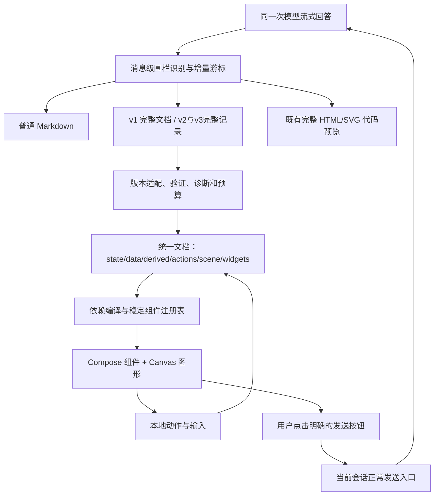

# RikkaHub 交互式可视化：完整最终实现方案

> 修订日期：2026-11-15（Asia/Shanghai）。  
> 定位：结合当前仓库、用户补充建议及公开资料的实施定稿。按本文完整实现并统一交付，不划分阶段，不以多轮审计、逐项验收或性能研究作为开工条件。  
> 当前代码已有 v1/v2 原生可视化、流式记录、本地交互和 HTML/SVG 代码预览；本文定义的预置组件扩展及 v3 尚待实现。文档定稿不表示功能或构建已完成。  
> 本次修订以当前工作区为基础；已有未提交、未跟踪的代码均须保留。文末给出具体改动位置、一次性验证方式及回滚边界。

## 1. 最终决定与产品目标

采用 **“预置组件 + 自由图形描述 + 既有动态代码预览”并存** 的方案：

- 常见参数、步骤、状态、序列和表格交互，由模型发送简短的结构化描述，客户端复用已实现的原生组件。
- 特殊几何、算法示意、自定义连线和曲线，继续使用现有 Compose Canvas 图元、表达式、状态及流式增删改能力。预置组件可以和自由图元出现在同一张卡片里。
- 既有 HTML/SVG 及其中 JavaScript 的预览能力继续保留，满足更自由的页面定制。它与原生可视化属于不同运行路径，不把任何一条路径删除或强制改写成另一条。
- **收到一条完整、合法的组件记录，就展示该组件；收到合法更新，就更新现有组件。无需等待回答结束，也无需等待整张卡片或整个围栏生成完毕。**
- 输入、选择、滑块、前后步骤默认本地响应；只有用户点击明确表示发送意图的按钮，才把选定状态作为正常用户消息交给 AI，并继续流式回答。

目标体验是：先看到有含义的内容，随后图形、状态和控件持续补全；图卡可以边生成边操作；一处局部错误不吞掉其他内容；模型不用每次重新编写完整 UI。CPU、排序和函数是通用能力的使用场景，不为每道题单独写死界面。

本方案的交付范围为 **Android 主聊天的原生可视化增强及既有代码预览兼容**。仓库内 `web-ui` 是独立 Web 客户端，本次不以新增 Web 端同等组件、实现 MCP Apps 宿主或接入 ChatKit 托管服务作为依赖；这些也不列为本文后续阶段。功能完成标准见第 13 节。

## 2. 公开项目如何借鉴，哪些判断需要纠正

资料核对时间为本次修订日。下列依据来自公开仓库与官方文档，并非 ChatGPT Android 私有源码。

### 2.1 Apps SDK UI：借鉴组件设计，不将 React 组件直接搬进 Compose

[openai/apps-sdk-ui](https://github.com/openai/apps-sdk-ui) 提供 React 组件、CSS 变量设计 token、响应式及可访问性工具；当前 README 要求 React 18/19、Tailwind 4，部分组件基于 Radix。

本项目借鉴它的组件粒度、间距、信息层级、输入错误及禁用状态，转换为 Compose 参数与 `MaterialTheme` 下的局部样式。Android 不为此安装 React/Tailwind，也不将 `AppsSDKUIProvider` 误当作 AI 状态机、MCP 宿主或生成式 UI 引擎。

“有开源 UI 库”只能证明有可复用的公开组件，不能证明录屏中的 ChatGPT 内置图卡就是这些组件生成的。

### 2.2 ChatKit Widgets：主要借鉴结构化组件与更新方式

[Widgets 文档](https://github.com/openai/chatkit-python/blob/main/docs/concepts/widgets.md) 给出了组件定义、数据 schema、模板、运行时对象、`WidgetItem` 及 JSON 传递关系；[交互响应指南](https://github.com/openai/chatkit-python/blob/main/docs/guides/build-interactive-responses-with-widgets.md) 演示连续产出 widget 状态，通过 `stream_widget` 生成更新事件。

直接采用的设计思想是：客户端认识组件类型，模型或服务提供内容、参数、绑定与动作；同一稳定 ID 的组件可以更新，不需要重新生成完整页面。

需要纠正两点：

1. ChatKit 文档中的流式 widget 不等于执行未完成的 JSON 或 JavaScript。公开指南还区分了带 ID 的 Text/Markdown 文本增量与其他组件差异引起的客户端重渲染；不能概括成所有组件都支持任意字段的逐 token 执行。
2. ChatKit 的 schema 是其自身组件体系，RikkaHub 的 schema 是下面定义的原生协议；借鉴结构不等于宣称协议兼容。本文不直接接收 `.widget` 文件，也不声称支持全部 ChatKit Widgets。

### 2.3 ChatKit Actions：明确本地动作与发给 AI 的动作

[Actions 文档](https://openai.github.io/chatkit-python/concepts/actions/) 与上述指南区分客户端处理和服务端处理；公开 SDK 的动作默认走服务端，设置 `handler: "client"` 才交给前端回调。

RikkaHub 有意采用适合离线交互的默认值：原生控件动作默认本地，只有显式 `kind: "message"` 才允许走正常聊天发送。借鉴的是动作分工，而非照抄默认行为或引入 Python 服务。

### 2.4 ChatKit JS：公开接入代码不等于完整离线渲染器

[ChatKit JS README](https://github.com/openai/chatkit-js) 的接入方式包含 CDN 上的 `chatkit.js`；[官方文档源码](https://github.com/openai/chatkit-js/blob/main/packages/docs/src/content/docs/index.mdx) 的托管／自托管对照明确写明，两种后端方式下承载聊天 UI 的 iframe 均由 OpenAI 托管。

因此，本方案不将“有公开仓库”推导为“整个 ChatGPT 聊天 UI 或内置动态 UI 引擎已开源”，也不以接入 ChatKit 远端 iframe 来替换本地多提供商聊天。公开的类型、示例及交互概念足以指导本次原生设计。

### 2.5 MCP Apps：借鉴宿主边界，不把协议当成组件库

[modelcontextprotocol/ext-apps](https://github.com/modelcontextprotocol/ext-apps) 及 [2026-01-26 规范](https://github.com/modelcontextprotocol/ext-apps/blob/main/specification/2026-01-26/apps.mdx) 定义工具关联的 `ui://` 资源、`text/html;profile=mcp-app`、宿主与视图通信、初始化与能力协商。它还定义 `ui/notifications/tool-input-partial`、完整 input、result 和 cancelled 等通知。

可借鉴模板与数据分离、稳定生命周期、能力声明、取消传播、文本回退。MCP Apps 的 partial input 不意味着任意半截模型输出可以执行；MCP 客户端支持普通工具调用，也不自动意味着已经实现 Apps 宿主。

本次不扩展 MCP 连接器、不实现 iframe 消息桥、不增加第三种可视化工具通道。图卡仍从现有 Markdown 围栏进入，避免为了一个功能重构外部应用接入层。

### 2.6 依赖与许可的处理决定

本次以思想和公开接口设计为参考，自行实现 Kotlin/Compose 组件，不新增外部 UI 依赖，不整包移植上述项目。若实施时确实复制源码，再固定具体提交并保留该版本所需的许可与署名；不能只根据项目名称推断许可。尤其 ext-apps 当前 LICENSE 说明存在 MIT 向 Apache-2.0 的迁移及文档许可区分。

公开 SDK、开放协议、开源客户端是三个不同概念。以上公开材料不能确认 ChatGPT Android 客户端或录屏中动态 UI 系统的完整内部实现。

## 3. 当前仓库已经具备什么，实际缺口在哪里

### 3.1 已有原生渲染及数据通道

- [VizSchema.kt](../app/src/main/java/me/rerere/rikkahub/data/visualization/VizSchema.kt) 定义 `VizSpec`、动作、节点、图元、帧和流状态；[VizParser.kt](../app/src/main/java/me/rerere/rikkahub/data/visualization/VizParser.kt) 读取完整 v1 文档。
- [VizStreamParser.kt](../app/src/main/java/me/rerere/rikkahub/data/visualization/VizStreamParser.kt) 已按完整 NDJSON 行推进 v2，支持 `init/shape/replace/remove/node/replaceNode/removeNode/state/action/done`。因此“从零新增流式渲染”不是本次任务。
- [VizEngine.kt](../app/src/main/java/me/rerere/rikkahub/data/visualization/VizEngine.kt) 和 [VizExpression.kt](../app/src/main/java/me/rerere/rikkahub/data/visualization/VizExpression.kt) 已提供本地表达式、动作原子更新及图元编译；[VizCanvas.kt](../app/src/main/java/me/rerere/rikkahub/ui/components/visualization/VizCanvas.kt) 负责原生绘制、等比例适配和裁剪。
- [VizSessionStore.kt](../app/src/main/java/me/rerere/rikkahub/ui/components/visualization/VizSessionStore.kt) 已有本地状态、后续 spec 合并、默认 48 项的 LRU 和消息清理；该值是现有实现，不是本次测量得到的最佳容量。
- [VisualizationBlock.kt](../app/src/main/java/me/rerere/rikkahub/ui/components/visualization/VisualizationBlock.kt) 已支持源码、复制、重置、流式状态；基础视图目前为 text、row、column、button、slider、scene。
- [VizPrompt.kt](../app/src/main/java/me/rerere/rikkahub/data/visualization/VizPrompt.kt) 已注入协议说明；[GenerationHandler.kt](../app/src/main/java/me/rerere/rikkahub/data/ai/GenerationHandler.kt) 根据助手和全局设置启用。不能另造一个无视现有开关的注入入口。

### 3.2 动态代码能力的准确边界

[HighlightCodeBlock.kt](../app/src/main/java/me/rerere/rikkahub/ui/components/richtext/HighlightCodeBlock.kt) 对完整 HTML/SVG 代码提供预览，使用 `buildCodePreviewHtml` 与 WebView；HTML 可含 JavaScript。[WebViewPage.kt](../app/src/main/java/me/rerere/rikkahub/ui/pages/webview/WebViewPage.kt) 承接全屏页面；[WebView.kt](../app/src/main/java/me/rerere/rikkahub/ui/components/webview/WebView.kt) 已启用 JavaScript 等能力。

这些能力要保留。但 `rikka-viz` 本身运行的是声明式数据和受限表达式，并非任意 JS；独立 `web-ui` 的 Vite/React Router 构建链也不代表 Android 预览能自动编译任意 TSX、导入 npm 依赖或运行完整 React 项目。本文不新增此类承诺。

### 3.3 必须一起解决的缺口

1. `text/label` 当前要求字符串，数字绑定会触发“需要字符串”；只修显示字段，不放宽操作名、颜色、ID 等结构字段。
2. JSON 与状态深度限制为 24；树形表达式很快触及该限制。需要统一预算，并提供数据与派生值复用以减少嵌套。
3. 单条异常设置 `failed=true` 后，后续记录不再处理；需要记录隔离与明确的序号恢复。
4. 流解析反复 `root.toString()` 再解析整图，完整解析又构帧，session 更新再次构帧；需要取消重复工作并保持资源检查。
5. `view.first()` 被假定为主 scene，追加 node 只能位于其后；需要独立主场景和布局区域。
6. 缺少数值输入、选择、步骤器、带标签图形、连接器、序列与紧凑表格；模型不得不输出大量重复低层结构。
7. [PreparedMarkdown.kt](../app/src/main/java/me/rerere/rikkahub/ui/components/richtext/PreparedMarkdown.kt) 重扫当前和前置 part；[AssistantMessageMarkdown.kt](../app/src/main/java/me/rerere/rikkahub/ui/components/message/AssistantMessageMarkdown.kt) 每轮处理后固定 `delay(50)`，完整记录可能额外排队。
8. 现有按钮只更新本地状态。可视化事件还没有专用的正常聊天发送路径；`onToolAnswer` 是工具问答/批准，不可借用。

用户报告的“需要字符串”“JSON 嵌套超过 24 层”与上述代码路径相符；未取得失败图卡完整源码，不能把合成用例写成已复现用户原始输出。缺少原始输出不阻塞已明确缺陷的修复。

## 4. 最终架构与各层责任



统一文档是纯 Kotlin 数据，不存 WebView、Composable、Context 或模型可执行函数。组件注册表登记 `type`、字段 schema、默认值、依赖提取、编译及渲染处理器；未知类型产生局部诊断，不能反射加载任意类。

预置组件和自由图元共享状态、派生值、动作与更新队列。自由代码预览继续拥有独立生命周期，不从原生图卡自动注入脚本到通用 WebView，不因这次扩展增加新的原生桥。这样既保留自由度，又让常用交互无需每次生成页面代码。

## 5. 协议定稿：一个流式围栏，新生成使用 v3

### 5.1 版本决定及理由

保留 `rikka-viz` v1 的历史完整 JSON 读取及 `rikka-viz-stream` v2 读取；新生成使用同一个 `rikka-viz-stream` 围栏中的 `version:3`。

不把新语义悄悄塞进 v2：当前解析器严格拒绝未知字段、限制视图类型，并假定主 scene 位于 `view.first()`；新增布局、独立数据集及发送动作已经超出它的契约。明确 v3 可以保持 v1/v2 解释稳定，也避免自称旧客户端能运行新组件。

新客户端通过版本适配器将 v1/v2/v3 转成统一内部文档；v1/v2 原有动作仍为本地动作。旧客户端面对 v3 可能显示错误及源码，所以模型应在围栏外保留必要的文字结论；不能宣称旧客户端会自动得到新交互。版本不认识时只停止该块，普通正文继续展示。

### 5.2 v3 记录与 ID 规则

记录均为一个完整 JSON 对象加换行；`init` 无 seq，其余 seq 从 1 递增。字段不接受拼写近似或隐式代码。ID 长度 1–64，跨 widgets、图元、数据集、派生值和动作保持唯一；state 名称独立，表达式通过显式操作区分命名空间。以 `__` 开头的 ID 保留给运行时。

- `init`：必填 `op/version/id`，可选 `title/width/height/state/actions`。`width/height` 必须成对提供，默认 340×220；范围维持 32–2048。v3 不必先为一块空 scene 占满高度，收到首个可见图元时才显示主画布。
- `state`：沿用 `{op,seq,key,value}`，只新增可变状态及其默认值，不覆盖用户已操作值。
- `data`：`{op,seq,id,value}`，声明只读 JSON 数据集；value 是字面量，不执行其中的 `$` 结构。
- `appendData`：`{op,seq,id,items}`，只向已有数组数据集追加一批字面量，单次及累计均受数组上限约束。失败整批不提交，不重排已接受元素。
- `derived`：`{op,seq,id,value}`，声明命名表达式；先声明依赖，后声明引用者，不允许循环依赖、覆盖定义或写入 derived。
- `action`：沿用 `{op,seq,id,data}`，data 区分下面的本地和消息动作。
- `shape/replace/remove`：沿用 v2 形式，对主 scene 的稳定图元 ID 操作；新增高层图形类型也经这组操作进入。
- `node/replaceNode/removeNode`：沿用 v2 形式；新增记录字段 `slot`，取 `parameters/main/status/controls`。node 默认 controls；替换默认保留原 slot，显式 slot 可移动整个节点；槽内按首次接受顺序排列，替换不重新排队。
- `done`：`{op,seq}`，表示该块定义结束，不触发动作，不等同于整条模型回答结束。

区域顺序固定为 parameters → main → status → controls。主 scene 是 main 中独立的内部项，其元数据和图元不再依赖 `view.first()`；旧版本适配后仍保持它原有的 scene 在前、其他节点在后。v3 的布局节点可嵌套普通组件，但不能跨组件递归引用自身。

字段缺失、类型错误、未知字段、重复 ID 必须有定位信息；`replace` 不存在的对象不能偷偷变成新增。允许新增独立节点修复已跳过的记录，但不在客户端推测模型“本来想生成什么”。

### 5.3 表达式和数据复用

保留现有 `$` 表达式和其原子求值规则，新增四项：

- `{"$":["data","trace"]}`：读取只读数据集；`len/at` 复用现有数组操作。
- `{"$":["derived","current"]}`：读取命名派生结果，在同一状态与数据 revision 下缓存。
- `{"$":["field",对象表达式,"字段名"]}`：仅访问 JSON 对象的一个静态字段，不进行路径求值、属性链调用或宿主对象访问；字段不存在产生定位错误。
- 派生值按声明依赖的拓扑顺序求值；多个组件读取相同结果只计算一次，输入变化后只失效受影响项。

无需新增字符串公式语言。保留惰性 `if`；复杂演示优先用 `data + at + field` 和命名 derived，避免把每一帧展开成长 if 链。`get` 仍只读可变 state，不能隐式读取数据集或派生值。

### 5.4 精简且完整的 v3 示例

以下是拟实现的协议示例，不是当前 v2 可以直接执行的代码。第一个输入框所在完整记录到达就可展示；下一条图形可立即绑定已有状态；后续定义继续到达，不要求等待 done。

```rikka-viz-stream
{"op":"init","version":3,"id":"sum-demo","title":"参数与派生结果","width":340,"height":130}
{"op":"state","seq":1,"key":"a","value":5}
{"op":"state","seq":2,"key":"b","value":7}
{"op":"node","seq":3,"id":"input-a","slot":"parameters","data":{"type":"numberInput","label":"A","bind":"a","min":-100,"max":100,"step":1}}
{"op":"shape","seq":4,"id":"a-value","data":{"type":"labeledNode","x":20,"y":20,"w":300,"h":84,"label":"A","value":{"$":["get","a"]},"fill":"#C9DDF2"}}
{"op":"node","seq":5,"id":"input-b","slot":"parameters","data":{"type":"numberInput","label":"B","bind":"b","min":-100,"max":100,"step":1}}
{"op":"derived","seq":6,"id":"sum","value":{"$":["add",{"$":["get","a"]},{"$":["get","b"]}]}}
{"op":"replace","seq":7,"id":"a-value","data":{"type":"labeledNode","x":20,"y":20,"w":300,"h":84,"label":"A + B","value":{"$":["derived","sum"]},"fill":"#C9DDF2"}}
{"op":"action","seq":8,"id":"explain","data":{"kind":"message","prompt":"解释当前参数下的计算结果","include":["a","b"]}}
{"op":"node","seq":9,"id":"ask-ai","slot":"controls","data":{"type":"button","label":"发送给 AI 解释","action":"explain"}}
{"op":"done","seq":10}
```

这个例子用于说明绑定、提前展示和原地替换，不表示每次都应先画中间态再替换。实际生成优先直接输出最早可确定的最终组件，避免没有意义的占位与闪烁。

## 6. 一次完整交付的预置组件目录

下面是最终需要支持的有界组件集合，不是候选清单。普通 type 保持现有名称；扩展 type 仅在 v3 接收。用户可以在同一张图卡内组合这些能力。

### 6.1 布局与通用内容

- `text`、`row`、`column`、`button`、`slider`、`scene`：保留；row 在窄屏能换行，不把多个输入框按等宽硬挤到不可读。
- `status`：必填 text，可选 label、tone（neutral/info/success/warning/error），用于当前步骤、执行结果和说明。tone 由组件实现映射主题色，同时保留文本含义。
- 各 slot 只负责位置，row/column 负责区域内排列；scene 保持坐标比例，不随上下输入区域改变坐标单位。

### 6.2 参数控件

- `numberInput`：label、bind 必填，min/max/step 为有限常量，默认步长 1；支持键盘确认或失焦提交。输入期间的空字符串、负号、小数点属于本地编辑草稿，不立即污染数值 state。非法值显示字段错误，合法值经范围及步长规则提交；不在每次击键时跳变文本。与 slider 使用同一个 `min + round((value-min)/step)*step` 量化规则，并明确上下端点处理。
- `select`：label、bind、options 必填，options 为同类型标量 value 与显示 label 的列表；只能提交已声明选项，绑定类型不变。列表不超过 32 项。
- `toggle`：label、bind 必填，绑定布尔状态，修改立即本地提交。
- 控件所需 state 必须先存在。初值越界、类型不符或不可表达的 Float 滑块范围，局部显示原因，不让整张图卡消失。

### 6.3 步骤、序列、表格

- `stepper`：bind 指向整数 state，count 为整数表达式，label 可选；内置上一步、下一步、回到首步及当前位置。count=0 时显示等待步骤，禁用导航；count>0 时索引为 0..count-1，只能访问已接收数据。count 在追加轨迹后增长，不重置用户所在步骤。
- `sequence`：items 为有限数值数组表达式；mode 取 cells/bars，默认 cells；可选 label、roles。roles 是与 items 等长的角色字符串数组，取 normal/current/pivot/compare/sorted，既有颜色也有标记/文字区分。bars 按有符号数值绘制真实零基线，不能取绝对值伪造高度；空数组有明确空内容呈现。
- `table`：columns 为 `{key,label}` 列定义，rows 为对象数组表达式；单元格仅展示文本标量。最多 8 列、64 行，超宽只在组件内部横向滚动，保持聊天纵向滚动可用；不做电子表格公式或无限数据网格。
- stepper 只改变游标，sequence/table 读取 `at(data, step)` 派生结果。不把“点下一步”实现成向模型重新询问下一帧。

### 6.4 高层图形，与底层图元混合使用

- `labeledNode`：x/y/w/h、label 必填，value、subtitle、fill、stroke、sw 可选；统一圆角、标题/主值/副标题的排版及四边锚点。主值支持数字和布尔值，不需要模型手写字符串转换。可表示寄存器、树节点、状态格等。
- `connector`：from/to 必填，为 `labeledNode` ID；fromAnchor/toAnchor 可选，取 auto/top/right/bottom/left；可选 label、stroke、sw、arrow（none/start/end/both）、route（straight/orthogonal）。默认自动选择相向边、正交折线、末端箭头；坐标变化后重新算端点。首次实现不声称自动避开任意障碍物，复杂绕线继续用 polyline/path。
- connector 的端点必须已声明；删除仍被连接器引用的节点时拒绝该记录，模型需先删除连接器。替换节点保留 ID，使已有连接器自动更新。
- 现有 rect、line、circle、text、polyline、path、repeat、plot 均保留；高层图形编译后的实际图元也计入统一预算。连接器引用不能跨 scene，不支持对 repeat 展开的隐式 ID 进行寻址。

专门的数学函数图仍优先使用已有 `plot_function` 和 [FunctionGraphCard.kt](../app/src/main/java/me/rerere/rikkahub/ui/components/graph/FunctionGraphCard.kt)；需要与参数或算法状态组合时才使用可视化中的 plot。不得为本方案改坏已有等单位轴、单轴拉长、双指缩放和双击复位规则。

## 7. 流式接收、容错与真实可见时间

### 7.1 完整记录是提交单位，不是完整回答

1. 普通文本继续进入现有 Markdown 渲染。
2. 识别到顶层可视化围栏后，保存增量游标，只解码新增的完整 NDJSON 行。
3. 一行的 JSON、schema、引用及资源检查通过后，形成候选文档；所需帧也构建成功才原子提交。
4. 第一项有意义的内容立即请求发布；后续密集更新可按帧合并 UI 发布，但所有记录都按序处理。
5. done 只结束图卡定义，后面的普通说明继续显示。围栏闭合时允许处理最后一条没有换行、但已完整闭合的 JSON；取消且未闭合时不提交 pending 尾巴。

不会通过补引号、补括号、正则猜测字段来把半截 JSON 当成完整记录。未到换行的记录留在 pending；两个反引号等不完整关闭标记不能进入 JSON。v1 继续等完整围栏闭合，HTML/SVG 继续等完整代码及用户预览操作，**流式显示不扩大脚本执行时机**。

### 7.2 记录级恢复规则

- 已有合法 init 后，字段类型、未知组件、表达式、引用或重复 ID 等局部错误：不改文档和用户状态，记诊断并消费该 seq；下一条独立记录继续。
- JSON 损坏、无法信任 seq 的完整行：跳过物理行，不猜 seq；下一条合法 seq 可以向前重同步，最多跨过 32 个序号，明确记录缺失区间。超出则停止该块并提示重新生成。
- 相同 seq 与相同去除首尾空白后的记录内容重放：幂等忽略。相同 seq 内容不同：报冲突且不覆盖历史。保存有界的 seq/摘要账本；重放本身仍消耗输入行与字节预算。
- 依赖缺失不排入无限等待队列。该记录跳过，模型可在依赖补齐后用新的 seq 重发；其他内容照常呈现。
- init 无效时可在预算内寻找首条合法 init；一旦成功，第二个 init 不能清空已有会话。
- done 之后不接受图卡变更，额外记录产生诊断；不会重新打开文档。未知协议版本、流总字节或物理记录总量超限是块级终止，普通回复不受影响。

运行时一次本地动作失败，撤销该动作的全部状态写入，保留旧帧；不能把旧帧配上新 state，也不能因此销毁整张图。资源检查失败的候选记录不增加已接受文档的资源占用，但其原始输入仍计入流预算。

### 7.3 诊断与状态提示

诊断包含 code、severity、physicalLine、seq、op、itemId、fieldPath、message；最多保留 16 条详情及总数。后续成功记录不能清空先前缺项，最终显示“部分内容未生成”而非无条件成功。

默认仅显示简短提示，详情与源码在次级菜单；例如：`第9条记录，bar-label，data.text：需要文本标量，实际为数组`。不把整个 JSON 或实现栈塞进聊天卡片。

将生命周期和可操作性分开：receiving/complete/incomplete/cancelled/failed 是生成状态，单个控件是否可用由绑定和动作依赖决定。收到 done 后仍有缺项则 complete + diagnostics；用户停止且无 done 则 cancelled；流结束而缺 done 则 incomplete。已有合法控件在 receiving 期间也能操作。

## 8. 状态、动作、回传与算法正确性

### 8.1 本地状态与数据的分工

- state 是用户可改变的少量参数；data 是模型提供的只读数据或步骤轨迹；derived 是纯计算；编辑草稿属于 UI 本地状态。
- 后续流记录只能新增 state，不能覆盖用户已经输入的值。新组件绑定到已有 state 后应显示当前值，而不是 init 时的旧默认值。
- 本地 action 使用 `{kind:"local",set:{...},when:...}`；缺省 kind 仅在历史适配时解释为 local。所有右值读取同一旧快照，验证新状态和展示结果后一起提交。
- “重置参数”恢复全部默认 state 并清空输入草稿；stepper 的“回到首步”只修改该游标。不要把两个行为都标成含糊的“重置”。

### 8.2 明确的 AI 回传动作

`kind:"message"` 必填 prompt（字面量）、include（需要带入的 state key 列表，可为空），可选 when；不接受 URL、凭据、任意工具名或隐藏指令模板。单次快照序列化上限 8 KiB，超限显示原因，不截掉关键参数后默默发送。

只有用户主动点击按钮才构造消息，内容包括用户可见的 prompt、图卡标题及 ID、选定 state 的快照和来源标识。文字以“数据/当前参数”明确分隔，不升级为 system 指令。普通本地动作、图卡挂载、流式更新、重新进入页面都不自动发送。

回传路径为：`VisualizationBlock → AssistantMessageMarkdown / ChatMessage → ChatPage → ChatVM.handleMessageSend → ChatService.sendMessage`，适用中间容器一并透传回调。具体发送状态由聊天层负责，可视化层不持有 service。

必须走现有正常用户消息持久化与当前助手生成链路；[ChatVM.kt](../app/src/main/java/me/rerere/rikkahub/ui/pages/chat/ChatVM.kt) 的 `handleToolAnswer` 和 `onToolAnswer` 只处理既有工具调用，不能用于伪造组件发送。这样不改变各提供商请求协议，也不需要 Python 后端。

同一动作发送期间禁用重复点击；会话正在生成时禁用消息动作并显示简短原因，本地动作仍可用。点击时重新确认图卡属于当前会话可见分支，快照取点击瞬间值。发送失败可重试，但已被聊天层接受的同一事件不能再次插入用户消息。新回答作为正常新消息显示，不偷偷改写来源图卡。

### 8.3 步骤轨迹与参数变化必须一致

CPU 5+7 示例可用用户参数、step 和 derived 表示 R1→Y、Y+R2→Z、Z→R1；derived 始终读取当前参数。修改参数时，在同一次本地更新中将该演示游标归零，重新得到一致结果。

对模型生成的快排轨迹，不宣称它可以适配任意新数组。data 可附带 `inputKeys` 与对应 `inputSnapshot`，声明该轨迹依赖的 state 输入；相关 key 变化后，组件显示“输入已变化，需要重新生成演示”，禁用轨迹导航，但保留来源说明。用户通过明确消息动作请求新轨迹，新回复生成新的图卡。未声明这些元数据的独立数据集不自动被解释为算法运行结果。

轨迹只追加已完成帧，stepper 的 count 来自已接收帧数；不会跳到还没生成的第 15 步。空数组、重复值、负数、逆序、已排序都按实际数据呈现，不能借颜色变化伪装正确计算。需要本地重算的算法只能使用明确实现且可验证的本地算子；本文不加入通用代码解释器。

## 9. 资源限制、类型修复与性能实现

### 9.1 统一限制并保留累计校验

新增集中限制定义，JSON 根深度为 0、最大 64；表达式最大 32 层操作嵌套，同时受 JSON 深度约束。统一解码、程序化文档、状态及表达式校验，不只修改一处常量。

保持现有主要边界：每消息最多 4 块，每块原始流 64 KiB，单条 8 KiB，最多 512 条非空物理记录，state 32 项，字符串 2048 字符，数组 256 项，view 64 节点，实际展开图元 512，repeat 64 次且嵌套不超过 2，plot 每条 2–512 点且总计 2048，单次求值预算 50,000 步。新增 data 最多 16 个、derived 最多 32 个、action 64 个；data 的累计内容同样受文档字节与结构预算约束。

协议原始流和当前逻辑文档分别累计预算。替换/删除按新旧差额更新，失败回滚；高层节点展开后的图元、表达式实际执行、曲线采样也计数，不能靠一个短 `labeledNode` 或 repeat 绕过限制。节点数按整棵树计，不只是根节点。大于单条上限的输入拒绝，不无限缓存等待。

### 9.2 只为显示字段做标量格式化

text、label、value 等明确的显示字段接受 string、有限 number、boolean；数字使用 Locale.ROOT 稳定格式，整数不带多余 `.0`，负零显示为 0，小数保留有意义精度，可用现有 fixed 明确位数。空值可用组件定义的占位符；数组、对象不能自动 stringify 冒充文本。

`type/op/id/bind/action/color/path/anchor` 等仍严格类型校验。避免全局将 `str()` 替换成 `toString()`，否则真实结构错误将被隐藏。运行期某显示节点失败时保留其上次有效内容并标注局部异常；首次失败显示局部说明，不拖垮其他独立组件。

### 9.3 取消重复解码和重复构帧

把 JSON 解码、文档 schema 检查、依赖编译、初值验证、当前帧构建分开：

- 每条原始记录只解码一次；去掉 `root.toString()` 再 parse 的往返。
- `parseElement` 不再隐式触发整帧构建；调用者通过清晰的加载/增量入口完成验证和必要构帧。
- 节点保存稳定 ID、定义 revision、依赖集合与资源贡献；新增只编译新增项，替换/删除处理其反向依赖；state/data 改变只失效依赖节点及 derived。
- 默认状态与当前状态一致时复用验证结果；不一致时，对变化部分分别验证默认态和当前态，保证“重置参数”仍有合法目标。
- 静态路径、文字测量、曲线采样缓存按内容 revision、相关状态、尺寸、density/fontScale、主题等真实输入失效；缓存命中不能免除整帧累计资源预算。
- Canvas 可以正常整体重绘；避免的是不必要的文档、表达式和几何重建，不承诺逐像素局部重绘。

### 9.4 增量 Markdown 与调度

保留现有 AST 为语义依据，顶层围栏识别、普通代码、引用、反引号/波浪线和 CRLF 行为不变。已确认且持续追加的活动围栏使用增量游标，保留未完成行与关闭标记；边界不明确或发生非追加编辑时回到完整扫描。完成 part 的围栏计数缓存，避免每次重扫全部 precedingSources。

原始图卡数据先受保护再进入显示正则或 LaTeX 预处理；AST/DOM 共用同一版本的准备结果。不能为了快把所有 Markdown 解析替换成简单正则，也不能把引用、用户消息、思考或工具结果中的示例自动当成交互卡片。

保留 `conflate` 对展示快照的合并，但不能丢记录增量。用最新完整文本与已消费偏移推导所有新增完整记录；首个有意义组件、done/闭合、取消优先发布。去掉每次处理后机械追加的 `delay(50)`；连续更新按帧合并，最多处理一小批记录就让出执行，避免单个大 chunk 占满 UI 线程。

每个 session 使用串行处理队列组织模型记录、用户动作和重置；解析/编译在后台，Compose 快照原子发布。store 全局锁仅管理索引与 LRU，不跨会话持锁编译。过期队列结果提交前核对会话 epoch，删除、编辑、重生后旧结果不得复活。

## 10. 卡片呈现、生命周期及降级

卡片标题保留，操作以内容为中心：参数在上、主图居中、状态/步骤在下、主按钮位于操作区；源码、复制及诊断收到次级菜单，通用重置与演示自带重置避免重复。

第一条可见组件到达即显示；未出现图元时只保留紧凑的生成状态，不展示大块空白 Canvas。收到图元后固定该 scene 的比例，逐步填充，不为每条记录重复淡入。已有用户输入不因新记录失焦；宽度按聊天内容区处理，不改变平板永久侧栏或手机导航动效判断。

沿用应用字体和主题。图形可以用协调的马卡龙/莫兰迪配色，浅填充配深文字，透明区域配主题文字；不增加应用主题切换，不将几种装饰色强制用于每张图。输入与按钮保持合适触摸目标和语义标签；绘图另有可读标题/摘要，不仅通过颜色区分状态。

会话身份使用会话、消息版本、part、围栏身份与内部 epoch，不能用变化中的整段文本 hash 重建流式 session。局部控件状态可在当前 LRU 生命周期内保留；LRU 驱逐、进程重启后重放原文并恢复默认状态，不宣称输入跨进程持久化。原文继续作为导出/分享依据，初始文字结论保留在围栏外。

关闭全局/助手可视化功能时遵循现有语义，不能再注入新协议或回传能力。未知版本、超出 4 块、解析失败均保留源码入口与普通正文。旧 v1/v2 导出、复制、朗读过滤继续有效；HTML/SVG 源码及预览不被新组件接管。

## 11. 提示词与能力声明

提示词由客户端实际注册的能力生成，统一列出当前推荐版本、组件 type、操作、表达式及限制。只宣传已经实现的能力；避免 schema 支持一套、提示词写另一套。

生成规则固定为：

1. 普通问题正常回答；函数图优先已有专用工具，普通流程图可用 Mermaid，交互参数/步骤使用 v3，自由页面需求保留 HTML/SVG 代码路径。
2. 单次回答中流式输出完整短记录：最小 init → 必要的少量 state → 第一项有意义内容 → 其余图形/数据/控件。不要先输出整套算法轨迹再开始显示，也不要为了预置组件额外发一次模型请求。
3. 优先 labeledNode、connector、sequence、stepper 等高层组件；只有需要自由度时细化为底层图元。图卡所需依赖先声明，record 到达即可运行。
4. 用 data、derived 复用数据与计算；按合理小批次 appendData，不将所有数据塞进 init，不用冗长 if 链表示步骤。
5. 所有 state 默认值合法，步骤范围只覆盖已到达数据；区分与输入绑定的轨迹和可重算模型。
6. 不输出 JS 到原生协议，不通过消息动作隐藏发送。按钮标签明确说明本地操作或“发送给 AI”。
7. 输出 done 并闭合围栏，后续解释在围栏外；不把空画布或“就绪”字样当作已经完成的证明。

仅保留一份短完整示例及必要字段说明，不向模型同时灌输全部历史版本。新旧版本兼容由读取器承担。保留现有模型、推理等级、提供商与 streamOutput 设置；若用户关闭流式，只能在收到完整响应后展示，不能绕过该设置伪造网络增量。

## 12. 具体实施文件与修改边界

以下均是工作项，不以文件是否已经存在判定功能已完成。现有 visualization 目录和测试有未跟踪内容，禁止覆盖重建整个目录。

### 12.1 协议、引擎与组件

- `data/visualization/VizSchema.kt`：统一文档、状态、只读数据、derived、节点身份和诊断载体；移除主 scene 必须占第一个 view 的耦合。
- `VizParser.kt`：v1/v2/v3 适配，schema 与初值/帧构建分离；程序化输入仍检查累计结构限制。
- `VizStreamParser.kt`：v3 记录、局部恢复、序号账本、候选事务、appendData、取消/结束规则。
- `VizExpression.kt`：data/derived/field、依赖提取、拓扑校验、深度预算、共享求值和显示格式化。
- `VizEngine.kt`：高层图形展开、控件校验、本地动作事务、默认态与当前态、依赖编译；独立处理消息动作，不调用网络。
- 新增 `VizLimits.kt`、`VizDiagnostics.kt`、`VizComponentRegistry.kt`、`VizCompiler.kt`：分别集中限制、定位诊断、类型 schema/能力表、编译缓存。只有确有独立职责才拆文件，不为文件数量再造框架。
- `ui/components/visualization/VisualizationBlock.kt`、`VizCanvas.kt`：区域布局、局部错误、延迟挂载 scene、次级菜单和图形绘制。
- 新增 `VizWidgets.kt`：numberInput/select/toggle/status/stepper/sequence/table 的 Compose 实现；labeledNode/connector 经图元编译与 Canvas 路径渲染。
- `VizSessionStore.kt`：串行队列、短索引锁、epoch、稳定身份、数据/用户状态合并、缓存释放。

### 12.2 消息与事件接入

- `VizFenceScanner.kt`、`PreparedMarkdown.kt`、`AssistantMessageMarkdown.kt`：增量游标、前置计数缓存、稳定 slot、首内容发布和快照一致性。
- `ChatMessage.kt`、`ChatList.kt`、`ChatPage.kt`：透传明确定义的图卡发送回调及当前生成状态；新增参数放在尾随回调之前，逐处核对调用方。
- `ChatVM.kt`：图卡事件转为现有 `handleMessageSend`，处理来源/分支/重复提交；`ChatService.sendMessage` 正常持久化，无需新建工具执行协议。
- `VizPrompt.kt`、`GenerationHandler.kt`：仅注入已启用能力，保留现有全局与助手开关；不改账号认证或提供商模型能力。
- 复用 `Settings.kt` 与 `Assistant.kt` 的既有开关，不为此次实现增加多套需要用户理解的“组件模式/脚本模式”设置。
- HTML/SVG 代码预览相关文件原则上不改；仅在接入影响现有路由时做针对性兼容修复。`web-ui`、MCP 连接器、数据库消息格式不为本方案作无关扩展。

### 12.3 关键回归落点

复用 [现有可视化单测目录](../app/src/test/java/me/rerere/rikkahub/data/visualization) 和 [fixture 目录](../app/src/test/resources/visualization)，更新 `VizEngineTest`、`VizStreamParserTest` 及 `VisualMarkdownTest`。只补实际新增逻辑与已确认错误的回归，不给每个简单 UI 包装、每个常量各写重复测试。

协议定义 → 数据/组件实现 → 消息接入 → 提示词同步是编码依赖关系，全部属于同一次完整改动。中途可自查代码，不要求每完成一个文件就构建、审计或向用户申请下一步。

## 13. 一次性完成标准与验证方式

### 13.1 功能完成标准

最终代码必须同时包含：保留旧渲染及预览、上述完整组件集合、v3 流式接收与 v1/v2 读取、数字显示修复与统一深度、局部错误继续、数据/derived/步骤一致性、本地动作与正常聊天回传、重复计算消除、稳定状态和合理降级。不能只新增协议说明或几个 UI 空壳就宣称完成。

验证按用户要求收束为 **一次集中逻辑检查、一次集成验证**：

- 集中检查协议字段与提示词一致、候选提交原子性、步骤/输入同步、发送路径及旧版本兼容。
- 将必要的新增逻辑回归并入同一次 Gradle 调用：数字/深度边界、坏行后继续及状态不回退、组件与 derived、轨迹追加和输入失效、发送事件和 Markdown 边界。利用现有测试基础，不为验收构造庞大测试平台。
- 不将真机矩阵、连续录屏、每组件手工点击、全量 Lint、吞吐基准、跨模型重复生成或多轮审计作为本次完成的强制前置。现有设备可用时可做一次合并冒烟；无设备如实列为未实测，不因此停工。
- 只在出现编译/测试失败、又修改了相关代码或发现具体未解决风险时，针对原因复跑必要范围；通过后结束，不循环寻找新验收项。

CPU 示例结果应与 5+7=12 及时序一致；排序轨迹不得使用已失效输入；函数和自由图形保留原能力。这些用于集中检查实际逻辑，不要求逐个场景进行一整轮独立发布。

### 13.2 Windows 一次集成入口

冻结源码后使用现有脚本；默认验证 Github Debug 包及同一变体单测：

```powershell
& '.\scripts\Invoke-IntegrationChecks.ps1' -Tasks @(':app:testGithubDebugUnitTest', ':app:assembleGithubDebug') -MaxWorkers 1 -HeapMegabytes 4096
```

脚本已使用项目 JDK、离线、单次 daemon、Kotlin 进程内编译，并在 finally 中执行 Gradle stop。保持最多一个构建，不在构建过程中继续修改输入文件，不按进程名批量终止 Java。

如果当次任务明确交付 Release APK，把同次调用中的 assemble 任务换成 `:app:assembleGithubRelease`，不要为完成计划先后重复打 Debug 和 Release。构建前将需要保留的旧 APK 复制到独立 delivery 目录并校验哈希；不能只把备份留在 Gradle 的 variant 输出目录。

`app/google-services.json`、已有 Android/Gradle 缓存及 web 模块所需 pnpm 是原有构建依赖。缺失时报告具体阻碍，不擅自安装依赖或修改全局配置。本文本次只有方案修订，未执行这条构建命令。

### 13.3 性能验证保留最小观察，不设置研究门槛

可在本地调试中记录完整记录收到、首次有意义 UI 发布、动作提交三类时间及字节/记录数；记录只含诊断元数据，不含正文或凭据。先确认没有“收到合法组件仍等待整段结束”的结构性阻塞。

不承诺比 ChatGPT 快多少，不预先宣称输出减少 30% 或固定 p95。若以后需要性能归因，再单独收集同任务同环境数据；本次改动不依赖这些统计。编译通过表示构建与接口匹配，单测通过表示覆盖的逻辑有效；手机触感和实际模型生成成功率未测时照实说明即可，不把它们混写成已验证。

## 14. 兼容、风险与回滚

- **改动原因与影响**：预置组件减少重复 UI 描述；流式提交改善等待感；容错避免局部坏记录阻断整张图；会话队列与依赖缓存避免重复解析和状态覆盖。影响集中在 Android 主聊天可视化，不改变模型供应商或账号体系。
- **兼容风险**：新版本数据不能在旧客户端直接运行；保留围栏外解释和源码。新客户端必须继续读 v1/v2，并使用相同历史默认值和动作语义。
- **状态风险**：后到记录、输入编辑草稿与异步编译可能竞争；通过候选事务、串行队列、epoch 和依赖 revision 控制，不能靠粗暴全卡重建掩盖问题。
- **计算风险**：大轨迹、深表达式及高层组件展开仍可能触及预算；按实际占用拒绝候选，保留已接受内容。提高深度并不表示允许无限程序。
- **代码预览边界**：既有 WebView 路径已有 JS 能力，本次不声称它获得了新隔离措施，也不让 v3 自动调用它。保留功能与引入自动执行是不同变更。
- **功能回退**：关闭现有可视化开关可停止原生展示/新提示注入；若只回退新生成，客户端能力表改回 v2，但保留 v3 解码或源码降级。回退提示词不能删除已经保存的新版本内容。
- **源码回退**：以本次实际文件差异和备份为单位，不 `reset` 整个工作区，不清理未知未跟踪文件，不覆盖用户已有工作；本计划不要求自动提交、推送或安装到手机。

原计划备份：[plan-before.md](../delivery/visualization-plan-revision-20261115-114708/plan-before.md)。已核对备份与修订前文件 SHA-256 相同：`1D4BD75B33708A7AD80E343EB6D22531E384C12805AACCA39A0D7CA5D0D9615B`。如只回退本次文档，核对路径后恢复该单文件即可；不会涉及现有功能源码。

## 15. 录屏依据与本次修订的证据边界

原始材料为 [Screenrecording_20261115_001652.mp4](../Screenrecording_20261115_001652.mp4)、用户错误截图、用户提供的 AI 回答、[原始引擎方案](<RikkaHub_AI交互式可视化引擎开发方案(1).md>) 和 [流式实现记录](流式可视化实现记录-2026-11-15.md)。以下是上一版已记录的观察，本次没有重新抽帧：

- 录屏约 34.65 秒；起点已有解释及部分卡片，不是请求发送时刻，不能据此计算首 token 延迟。
- 约 0.5 秒可见参数输入；约 4.5–6 秒寄存器框/标签逐步出现；约 8–16 秒连接线及更多模块出现；约 22–27 秒状态、步骤和操作按钮补全；其后继续普通解释。
- 这能支持“生成过程中逐步显示”的体验目标，不能证明内部使用 React、JSON、ChatKit 或某私有引擎，也不能推算双方快慢倍数。
- 录屏没有证明输入修改和下一步点击的实际结果；先前测试报告也不能代替本次新增功能的验证。

本次修订已核对仓库实现、公开组件/动作/协议资料，并将旧版的阶段安排、重复验收和候选路线替换为本文的最终决定。实施时按第 12 节完整修改，按第 13 节集中验证，然后交付实际改动及真实构建结果；不以新的审计轮次继续推迟功能完成。
